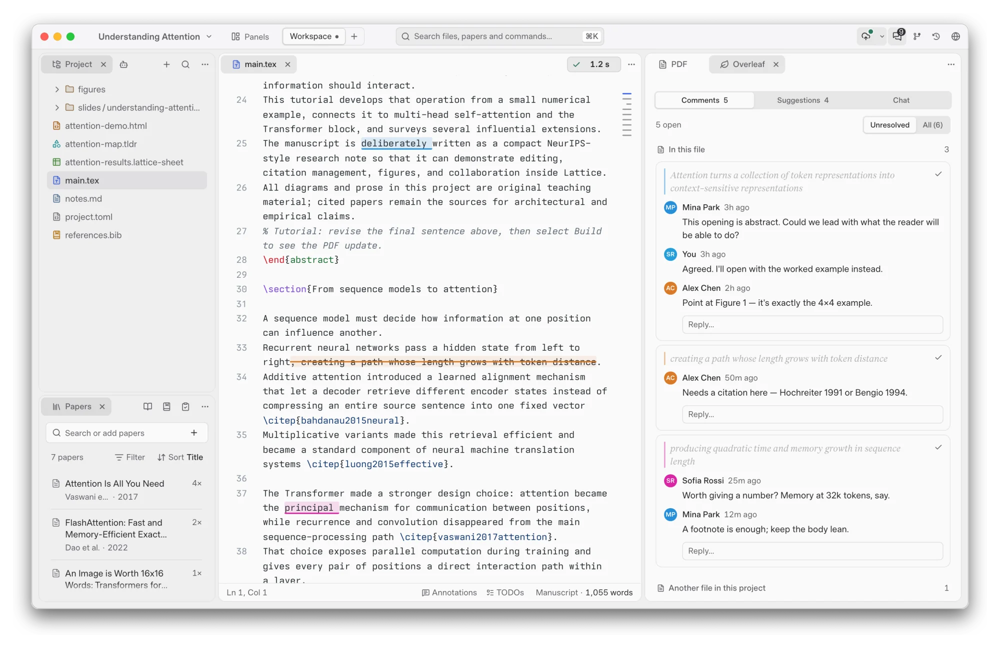
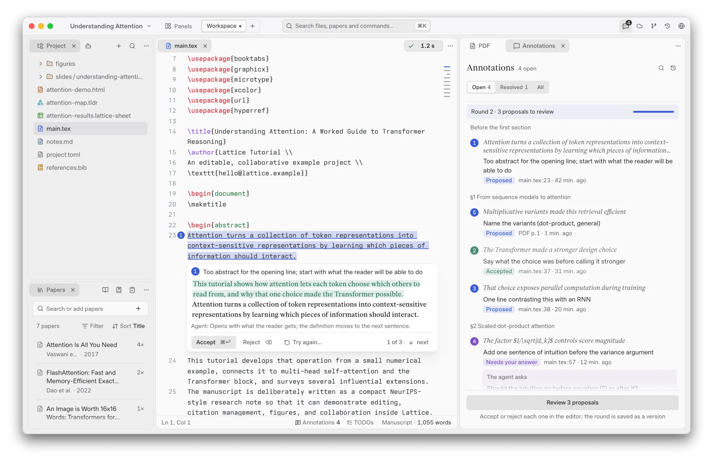
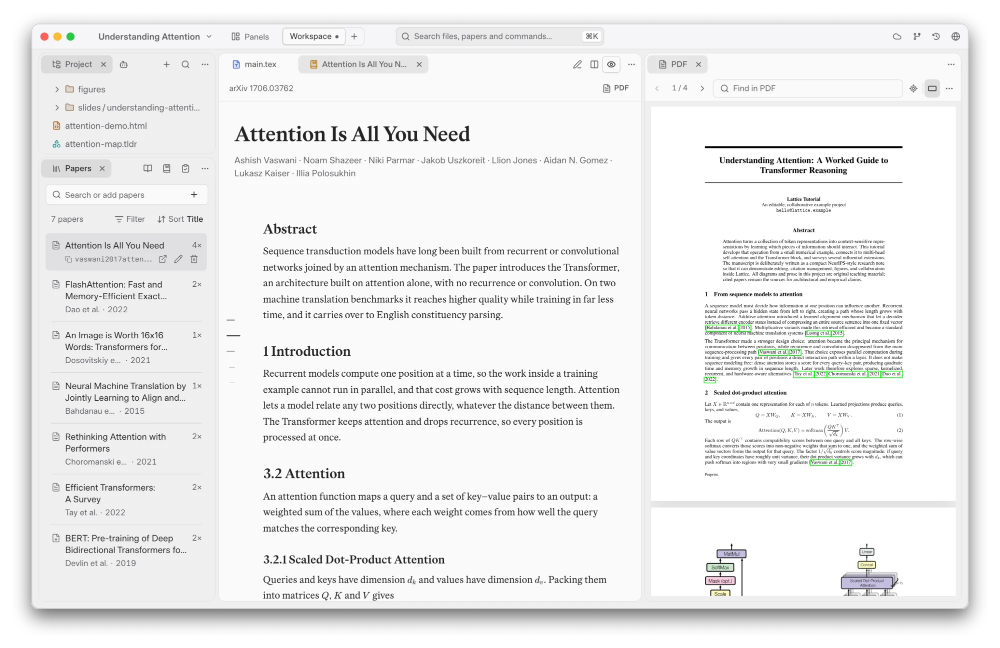
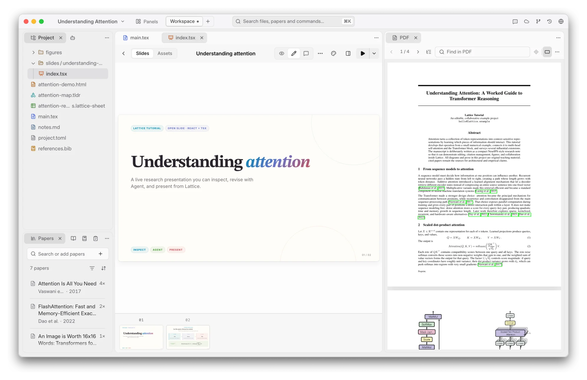
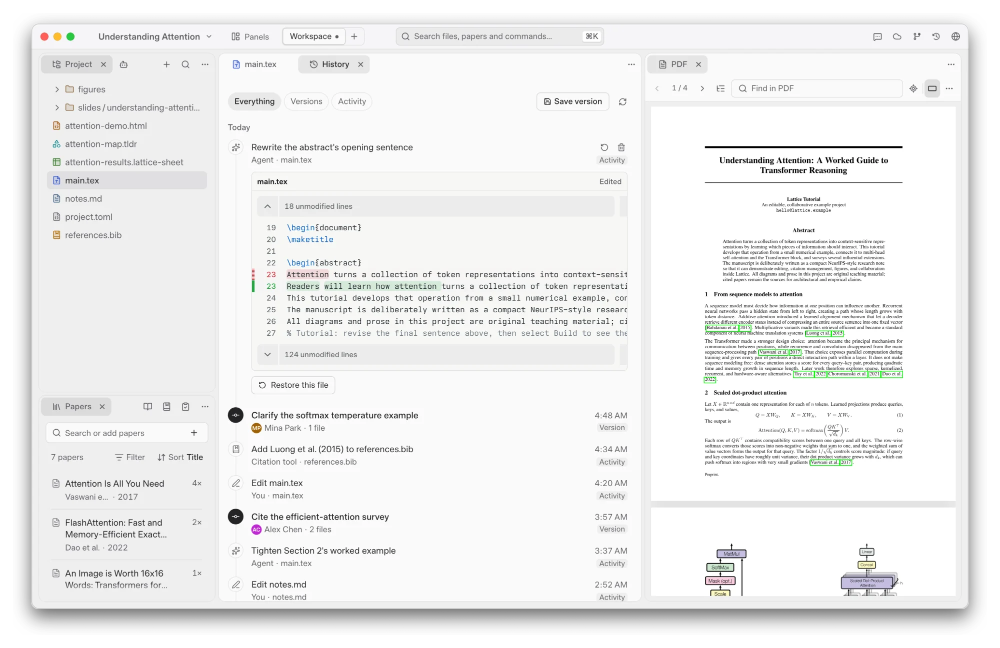

<h1>Lattice</h1>

A local-first LaTeX workspace for macOS, with your papers, your co-authors and an AI agent in the same window.

[Download](https://github.com/leo1oel/lattice/releases/latest) · [Website](https://leo1oel.github.io/lattice/) · [Docs](docs/README.md) · [Issues](https://github.com/leo1oel/lattice/issues) · [中文](README.zh-CN.md)

  <picture>
    <source media="(prefers-color-scheme: dark)" srcset="docs/images/hero-dark.webp" />
    
  </picture>

## Why Lattice

A paper is more than a `.tex` file: it is the PDF you check, the papers you cite, the comments your co-authors leave and, now, an agent that edits with you.
Lattice keeps all of them in one native Mac window.
Your project stays an ordinary folder on disk, so it works offline, opens in any other editor and fits under Git; Overleaf is a sync target, not the place your paper lives.

## Write

Source and PDF side by side, with completion, diagnostics, one-click builds and SyncTeX jumps both ways.
An outline rail follows your sections, `\cite` keys show their reference on hover, and six highlighters with meanings mark what still needs work.
Dock any panel anywhere, keep Writing and Reading layouts, or save your own workspaces.
Markdown notes, whiteboards and spreadsheets live in the same project, and **Import files…** brings in anything else from your Mac.

## Collaborate with Overleaf

Two-way Overleaf sync with live presence, chat, comments and tracked changes.
Comments read as conversations with one colour per person, and margin review sets comments and suggestions beside their lines without narrowing the text.

Annotate the source or the PDF, then revise from your annotations in rounds: the agent proposes an edit for each one and you accept or reject it in place.
**Export review PDF** writes the annotations you tick into a copy of the compiled PDF as standard PDF comments, so collaborators can read them in Preview, Acrobat or Zotero.

## Read and cite papers

Add papers by arXiv ID, DOI, title, link or BibTeX, read them as clean pages beside your draft, and cite in one step.
The library sorts, filters and groups by what you cite; **Check references** audits your bibliography against Crossref and shows each finding in a keyboard queue.

## Work with an agent

The Agent panel runs [Claude Code](https://github.com/anthropics/claude-code) or [Codex](https://github.com/openai/codex) with your own CLI sign-in.
It reads your project and papers, fixes build errors and edits files; every change shows as a diff you can review or undo, and suggested follow-ups appear as chips.
Select text to **Proofread** or **Polish** it in place, with a reason for each edit.

## Present

Slides are React decks powered by [Open Slide](https://github.com/open-slide/open-slide), kept in the same project as the paper.
Edit them, comment on them, let the agent revise them, and present from Lattice.

## Go back in time

One timeline for saved versions, every edit from you or the agent, and Overleaf's history.
Open any entry to see its diff and restore a file, or **Compare…** any two versions and export the PDF with the changes marked (via `latexdiff` from your TeX Live); the Git panel shows changes and pull requests when the project is a repository.

## Install

Lattice runs on Apple Silicon Macs with macOS 14 or later, and builds with your own [MacTeX](https://tug.org/mactex/) or TeX Live.

1. Download the `.dmg` from the [latest release](https://github.com/leo1oel/lattice/releases/latest) and drag Lattice into Applications.
2. Open a folder, start from a template, or connect an Overleaf project.
   **Guided tutorial** in the project menu opens a sample paper for a one-minute tour.

Official builds are signed, notarized by Apple, and update themselves.

## Contributing

To build from source, see [CONTRIBUTING.md](CONTRIBUTING.md) and the [architecture docs](docs/README.md).
Bug reports and pull requests are welcome; please open an [issue](https://github.com/leo1oel/lattice/issues) before a large refactor.

## Acknowledgements

Lattice stands on many open-source projects. The major ones:

- [Open Knowledge](https://github.com/inkeep/open-knowledge) (inkeep/open-knowledge) by Inkeep, the original basis of Lattice's earlier visual Markdown editor. Lattice has since replaced it with its own engine, but the editor began there, and we are grateful.
- [Trellis](https://github.com/DanFessler/trellis) by Dan Fessler, the dockable panel layout of Lattice's workspace. Uses Trellis by DanFessler - github.com/DanFessler/trellis.
- [Synara](https://github.com/Emanuele-web04/synara) by T3 Tools Inc. and Emanuele Di Pietro, the agent runtime behind Lattice's AI assistant.
- [Open Slide](https://github.com/open-slide/open-slide), which powers presentations.
- [Tiptap](https://github.com/ueberdosis/tiptap) and [CodeMirror](https://codemirror.net/), the rich-text and source editors.
- [PDF.js](https://github.com/mozilla/pdf.js), the PDF viewer.
- [tldraw](https://github.com/tldraw/tldraw), the whiteboard.
- [Tauri](https://github.com/tauri-apps/tauri), the desktop shell.

## License

Lattice is licensed under the [Apache License 2.0](LICENSE) (see also [NOTICE](NOTICE)), with the MIT-licensed [Synara](https://github.com/Emanuele-web04/synara) agent runtime by T3 Tools Inc. and Emanuele Di Pietro.
Releases up to and including 0.1.341 were GPL-3.0-or-later and remain available under those terms.
See [third-party notices](THIRD_PARTY_NOTICES.md) for component licenses and [Synara integration notes](docs/synara-runtime.md) for the runtime details.

Two components carry their own terms:

- The whiteboard's tldraw SDK (`tldraw`, `@tldraw/editor`, `@tldraw/driver`) is source-available under the [tldraw license](public/licenses/tldraw-LICENSE.md), which requires a license key for production use. Release builds read that key from the `VITE_TLDRAW_LICENSE_KEY` repository secret at build time; it is not in this repository, so a build without the secret runs tldraw in its unlicensed, watermarked mode.
- The workspace's panel layout, `@danfessler/trellis` (with `@danfessler/trellis-react`), is under its own non-commercial license with a commercial tier: see [its license](public/licenses/trellis-LICENSE.md), the [non-commercial terms](public/licenses/trellis-LICENSE-NONCOMMERCIAL.md) and the [commercial terms](public/licenses/trellis-LICENSE-COMMERCIAL.md). Those terms apply to anyone using Lattice: the free tier covers non-commercial use only, so use at a company or a for-profit organization needs a Trellis license from its author. Uses Trellis by DanFessler - github.com/DanFessler/trellis.
