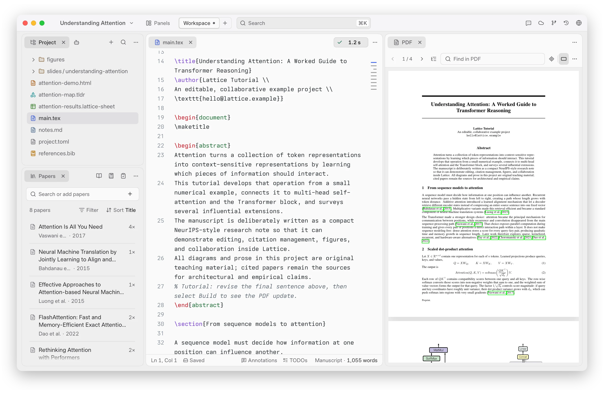
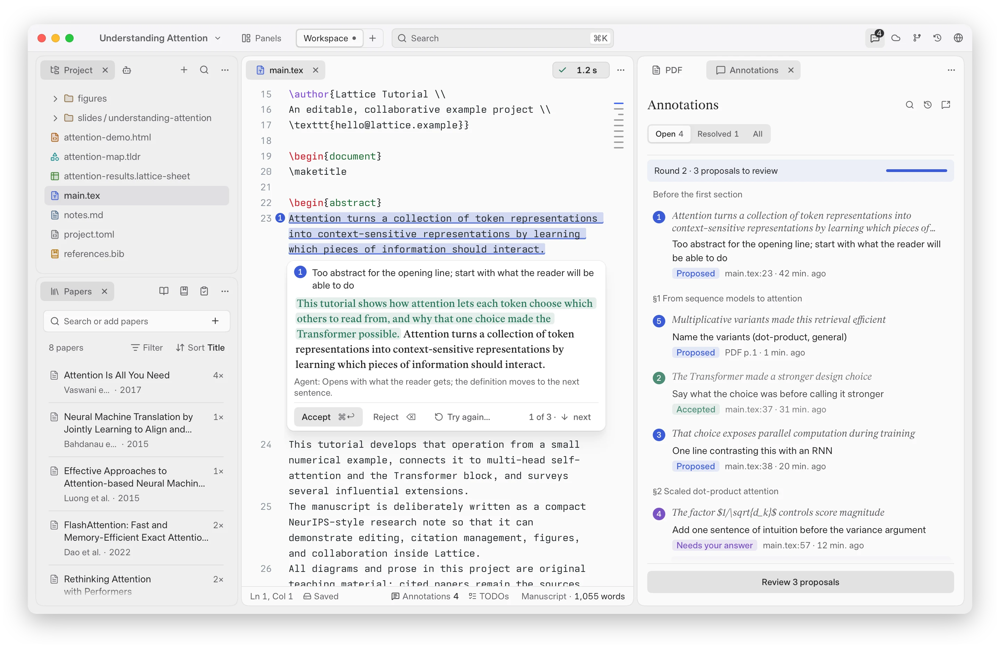
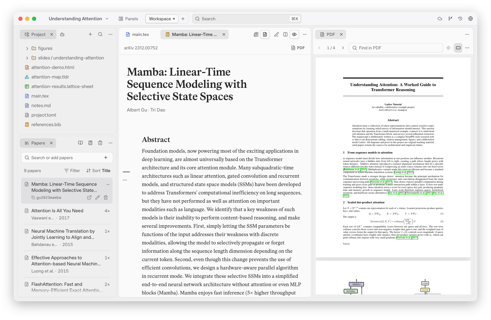
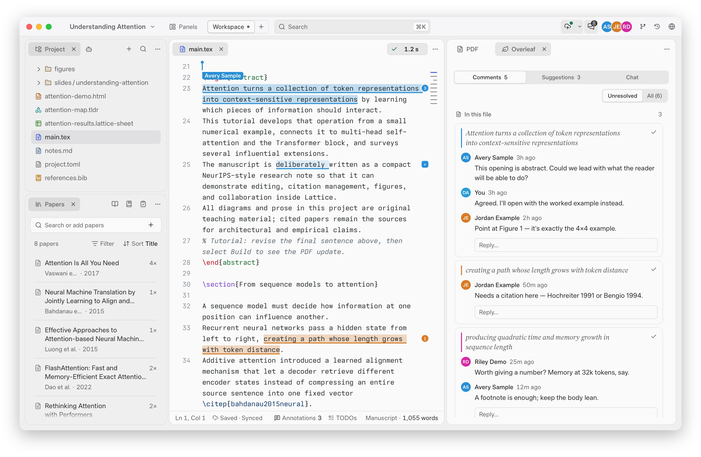
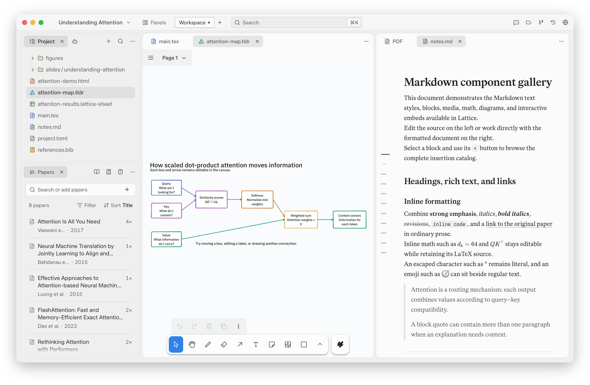
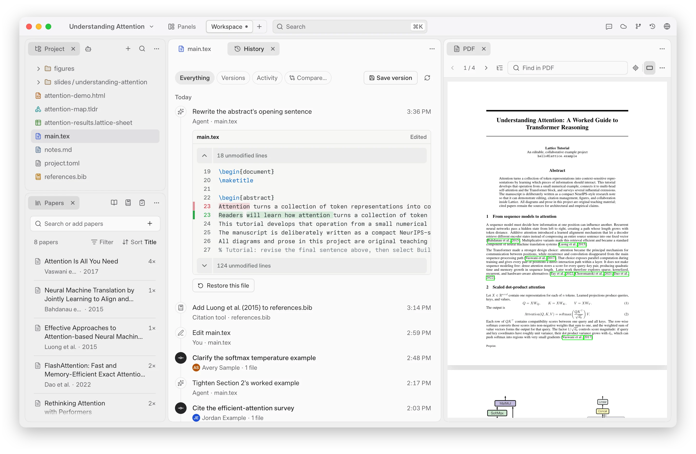

<h1>Lattice</h1>

A local-first LaTeX workspace for macOS, with your papers, your co-authors and an AI agent in the same window

[Download](https://github.com/leo1oel/lattice/releases/latest)&emsp;[Try it in your browser](https://leo1oel.github.io/lattice/demo/)&emsp;[Website](https://leo1oel.github.io/lattice/)&emsp;[Watch the film](https://leo1oel.github.io/lattice/#film)&emsp;[Release notes](https://github.com/leo1oel/lattice/releases)&emsp;[Developer docs](docs/README.md)&emsp;[Issues](https://github.com/leo1oel/lattice/issues)&emsp;[中文](README.zh-CN.md)

  <picture>
    <source media="(prefers-color-scheme: dark)" srcset="docs/images/hero-dark.webp" />
    
  </picture>

## Why Lattice

A paper is more than a `.tex` file: it is the PDF you check, the papers you cite, the comments your co-authors leave and, now, an agent that edits with you.
Lattice keeps all of them in one native Mac window.
Your project stays an ordinary folder on disk, so it works offline, opens in any other editor and fits under Git; Overleaf is a sync target, not the place your paper lives.

## Write

Source and PDF side by side (or the PDF in a window of its own, for a second screen), with completion and diagnostics as you type, SyncTeX jumps both ways and one-click builds with your own TeX Live.
Switch a `.tex` tab from **Source** to **Visual** to read and edit it with its headings, emphasis, equations, lists and figures drawn in place, in the same editor.
An outline rail follows your sections, `\cite` keys show their reference on hover, and six highlighters with meanings mark what still needs work.
Start from a NeurIPS, ICML, ICLR, ACL, CVPR or AAAI template or one of two thesis classes, and **Export for arXiv** writes one ZIP that builds on its own.
Dock any panel anywhere, keep Writing and Reading layouts, or save your own workspaces.

## Revise

Select text to **Proofread** or **Polish** it in place, with a reason for each edit.
Annotate the source or the PDF, then revise from your annotations in rounds: the agent proposes an edit for each one and you accept or reject it in place.
Annotations and Overleaf comments also line up in a column beside the PDF, each level with its mark on the page, where you read, reply to and resolve them.
**Export review PDF** writes the annotations you tick into a copy of the compiled PDF as standard PDF comments, so collaborators can read them in Preview, Acrobat or Zotero.

### Bring your own agent

The Agent panel runs [Claude Code](https://github.com/anthropics/claude-code) or [Codex](https://github.com/openai/codex), or another agent CLI on your Mac such as Cursor, OpenCode or Droid, signed in as you.
Or connect your own OpenAI- or Anthropic-compatible API in Settings › Agent › Model endpoint: an address, a key (kept in your Keychain) and model names, which the agent runs through Pi with no command-line tool to install.
Lattice comes with no model and no AI subscription of its own.
The agent reads your project and papers, fixes build errors and edits files; every change shows as a diff you can review or undo.
It can also use the MCP servers you add to that CLI, such as Zotero or Heptabase: see [Zotero, Heptabase and the Agent panel](docs/zotero-and-notes.md).

## Research

Paper shown: Albert Gu and Tri Dao, “Mamba: Linear-Time Sequence Modeling with Selective State Spaces”, arXiv:2312.00752, CC BY 4.0.

Add papers by arXiv ID, DOI, title, link or BibTeX, or straight from your Zotero library, and read each as a blog, the paper or the PDF beside your draft.
Cite in one step, with the reference on hover.
The library sorts, filters and groups by what you cite; **Check references** audits your bibliography against Crossref and shows each finding in a keyboard queue.

## Collaborate with Overleaf

Two-way Overleaf sync with live presence, chat, comments and tracked changes.
Your co-authors stay on Overleaf and their edits arrive as they type; nobody else needs Lattice.
Comments read as conversations with one colour per person, and margin review sets comments and suggestions beside their lines.

## Every format

Markdown notes edited in blocks, tldraw whiteboards, interactive HTML pages and spreadsheets with formulas live in the same project as the paper.
Slides are React decks powered by [Open Slide](https://github.com/open-slide/open-slide): edit them, comment on them, let the agent revise them, and present from Lattice.
**Import files…** brings in anything else from your Mac.

## History

One timeline for saved versions, every edit from you or the agent, and Overleaf's history.
Open any entry to see its diff and restore a file, or **Compare…** any two versions and export the PDF with the changes marked (via `latexdiff` from your TeX Live).
**Track changes** turns on review mode: your edits since then are marked in the source as you type, the PDF can show them marked too, and you accept or reject each change, or all at once, without an Overleaf plan.
The Git panel shows changes and pull requests when the project is a repository.

## Install

Lattice runs on Macs with macOS 14 or later, Apple silicon or Intel, and builds with your own [MacTeX](https://tug.org/mactex/) or TeX Live.
No TeX yet? Lattice offers to install BasicTeX for you: it is the first step of the Get started checklist, and a build that finds no TeX offers it too.

1. Download the `.dmg` from the [latest release](https://github.com/leo1oel/lattice/releases/latest) and drag Lattice into Applications.
   On a Mac with an Intel processor, download the one ending in `_x64.dmg` (Apple menu → About This Mac shows **Chip** on Apple silicon and **Processor** on Intel).
2. Open a folder, start from a template, or connect an Overleaf project.
   **Guided tutorial** in the project menu opens a sample paper beside Get started, a six-step checklist from building the PDF to letting the Agent revise a paragraph.

Official builds are signed, notarized by Apple, and update themselves.

**Linux (experimental).** Releases that pass their Linux checks also carry an x86_64 `.AppImage`, for Ubuntu 22.04 or later, Fedora 45 and similar distributions.
Make it executable (`chmod +x Lattice_*.AppImage`) and run it; it builds with the TeX Live from your distribution's packages.
On Linux, Lattice checks for new releases and links to GitHub Releases, but does not update itself; download each new release yourself. The built-in Agent is not available yet.

Windows (experimental). Releases that pass their Windows checks also carry an
unsigned x64 `windows-x64-experimental-setup.exe`, with a SHA-256 checksum and
setup instructions. SmartScreen may warn about the unknown publisher. The Agent
and automatic updates are unavailable; Lattice can install TeX Live for you from
its setup dialog, or you can install it yourself. See the
[Windows guide](docs/windows-host.md) for requirements and limitations.

## Contributing

To build from source, see [CONTRIBUTING.md](CONTRIBUTING.md) and the [architecture docs](docs/README.md).
Bug reports and pull requests are welcome; please open an [issue](https://github.com/leo1oel/lattice/issues) before a large refactor.

## Acknowledgements

Lattice stands on many open-source projects. The major ones:

- [Open Knowledge](https://github.com/inkeep/open-knowledge) (inkeep/open-knowledge) by Inkeep, the original basis of Lattice's earlier visual Markdown editor. Lattice has since replaced it with its own engine, but the editor began there, and we are grateful.
- [Trellis](https://github.com/DanFessler/trellis) by Dan Fessler, the dockable panel layout of Lattice's workspace. Uses Trellis by DanFessler - github.com/DanFessler/trellis.
- [Synara](https://github.com/Emanuele-web04/synara) by T3 Tools Inc. and Emanuele Di Pietro, the agent runtime behind Lattice's AI assistant.
- [Open Slide](https://github.com/open-slide/open-slide), which powers presentations.
- [Tiptap](https://github.com/ueberdosis/tiptap) and [CodeMirror](https://codemirror.net/), the rich-text and source editors.
- [PDF.js](https://github.com/mozilla/pdf.js), the PDF viewer.
- [tldraw](https://github.com/tldraw/tldraw), the whiteboard.
- [Tauri](https://github.com/tauri-apps/tauri), the desktop shell.

## License

Lattice is licensed under the [Apache License 2.0](LICENSE) (see also [NOTICE](NOTICE)), with the MIT-licensed [Synara](https://github.com/Emanuele-web04/synara) agent runtime by T3 Tools Inc. and Emanuele Di Pietro.
Releases up to and including 0.1.341 were GPL-3.0-or-later and remain available under those terms.
See [third-party notices](THIRD_PARTY_NOTICES.md) for component licenses and [Synara integration notes](docs/synara-runtime.md) for the runtime details.

Two components carry their own terms:

- The whiteboard's tldraw SDK (`tldraw`, `@tldraw/editor`, `@tldraw/driver`) is source-available under the [tldraw license](public/licenses/tldraw-LICENSE.md), which requires a license key for production use. Release builds read that key from the `VITE_TLDRAW_LICENSE_KEY` repository secret at build time; it is not in this repository, so a build without the secret runs tldraw in its unlicensed, watermarked mode.
- The workspace's panel layout, `@danfessler/trellis` (with `@danfessler/trellis-react`), is under its own non-commercial license with a commercial tier: see [its license](public/licenses/trellis-LICENSE.md), the [non-commercial terms](public/licenses/trellis-LICENSE-NONCOMMERCIAL.md) and the [commercial terms](public/licenses/trellis-LICENSE-COMMERCIAL.md). Those terms apply to anyone using Lattice: the free tier covers non-commercial use only, so use at a company or a for-profit organization needs a Trellis license from its author. Uses Trellis by DanFessler - github.com/DanFessler/trellis.
