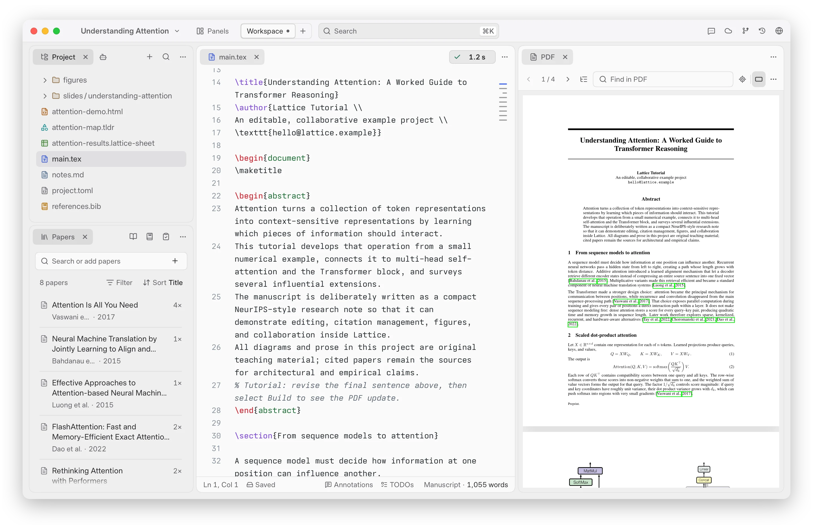
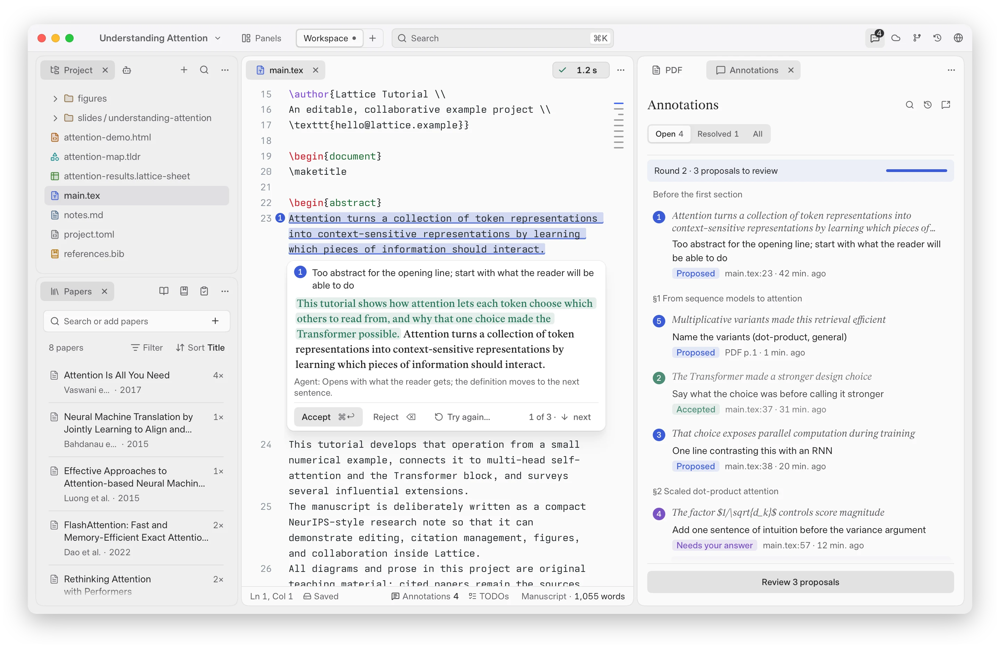
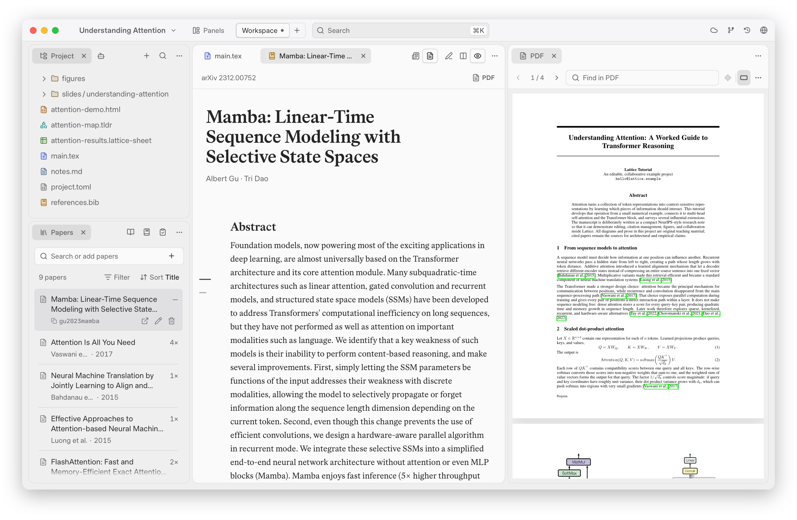
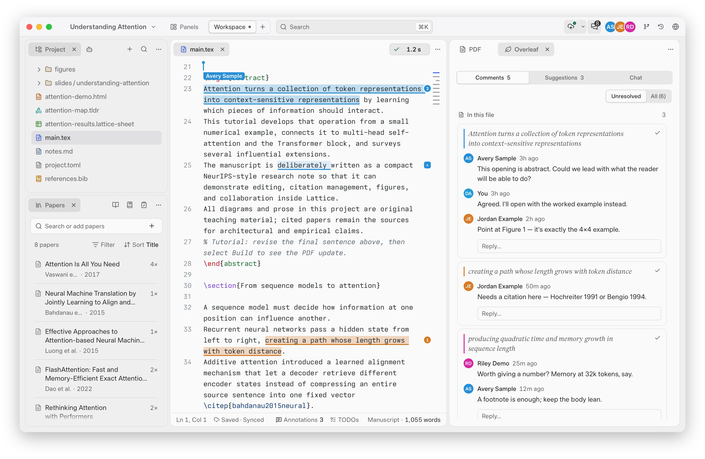
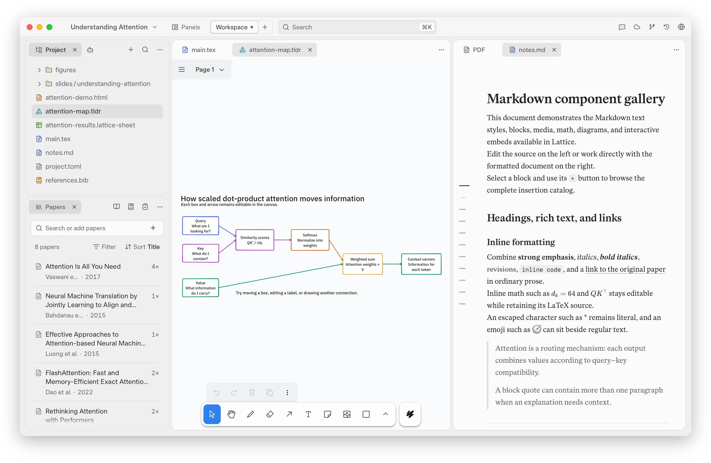
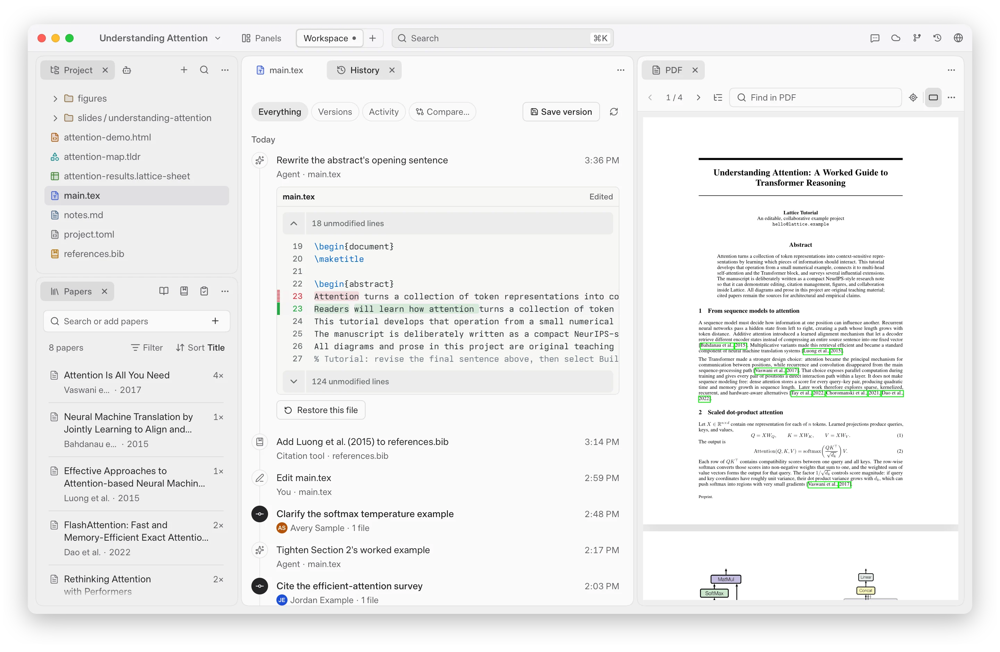

<h1>Lattice</h1>

macOS 上的本地优先 LaTeX 工作区：论文、文献、合作者和 AI 智能体在同一个窗口里

[下载](https://github.com/leo1oel/lattice/releases/latest)&emsp;[在浏览器中试用](https://leo1oel.github.io/lattice/demo/)&emsp;[官网](https://leo1oel.github.io/lattice/)&emsp;[观看短片](https://leo1oel.github.io/lattice/#film)&emsp;[更新日志](https://github.com/leo1oel/lattice/releases)&emsp;[开发者文档](docs/README.md)&emsp;[反馈](https://github.com/leo1oel/lattice/issues)&emsp;[English](README.md)

  <picture>
    <source media="(prefers-color-scheme: dark)" srcset="docs/images/hero-dark.webp" />
    
  </picture>

## 为什么是 Lattice

一篇论文不只是一个 `.tex` 文件：还有要核对的 PDF、要引用的文献、合作者的批注，以及和你一起改稿的智能体。
Lattice 把它们放进同一个原生 Mac 窗口。
项目始终是磁盘上的普通文件夹：离线可用，能用任何编辑器打开，也能直接放进 Git；Overleaf 只是同步对象，论文本身留在你的 Mac 上。

## 写作

源码与 PDF 并排：输入时就有补全和诊断，SyncTeX 双向跳转，用你自己的 TeX Live 一键编译。
把 `.tex` 标签页从 **源码** 切换到 **可视化**，就能在同一个编辑器里阅读和编辑排版后的标题、强调、公式、列表和图片。
大纲栏跟随章节，`\cite` 键悬停即显示文献，六种带含义的高亮笔标出还要处理的地方。
可以从 NeurIPS、ICML、ICLR、ACL、CVPR、AAAI 模板或两种学位论文模板新建，**导出 arXiv 提交包** 生成一个能独立编译的 ZIP。
面板可任意停靠，保留写作和阅读两种布局，也能保存自己的工作区。

## 修改

选中文字即可 **校对** 或 **润色**，原地修改，每处修改都附理由。
在源码或 PDF 上批注，再按批注逐轮修改：智能体为每条批注提出一处修改，你在原处接受或拒绝。
**导出评阅 PDF** 把勾选的批注以标准 PDF 注释写进编译好的 PDF 副本，合作者用预览、Acrobat 或 Zotero 都能看到。

### 用你自己的智能体

Agent 面板运行 [Claude Code](https://github.com/anthropics/claude-code) 或 [Codex](https://github.com/openai/codex)，也可以是 Mac 上的其他智能体命令行工具，比如 Cursor、OpenCode 或 Droid，都用你自己的账号登录。
Lattice 不自带模型，也没有自己的 AI 订阅。
智能体能读项目和文献、修复编译错误、编辑文件；每处改动都以差异显示，可以审阅或撤销。
它也能用你给这个命令行工具添加的 MCP 服务器，比如 Zotero 或 Heptabase：见 [Zotero, Heptabase and the Agent panel](docs/zotero-and-notes.md)。

## 文献

图中论文：Albert Gu、Tri Dao，“Mamba: Linear-Time Sequence Modeling with Selective State Spaces”，arXiv:2312.00752，CC BY 4.0。

通过 arXiv ID、DOI、标题、链接或 BibTeX 添加文献，也可以直接从 Zotero 文献库中勾选导入，在草稿旁以博客、论文或 PDF 的形式阅读。
一步引用，悬停即显示文献信息。
文献库可按引用情况排序、筛选和分组；**检查引用** 对照 Crossref 审核参考文献，并把每条结果放进可用键盘处理的队列。

## 与 Overleaf 协作

与 Overleaf 双向同步，支持实时在线状态、聊天、评论和修订。
合作者继续用 Overleaf，他们的编辑随打随到；别人都不需要安装 Lattice。
评论按对话呈现，每人一种颜色；页边审阅把评论和建议放在对应行旁边。

## 各种格式

块编辑的 Markdown 笔记、tldraw 白板、可交互的 HTML 页面和带公式的表格，都和论文放在同一个项目里。
幻灯片是基于 [Open Slide](https://github.com/open-slide/open-slide) 的 React 演示文稿：可以编辑、评论、让智能体修改，并直接在 Lattice 中放映。
**导入文件…** 可以带入 Mac 上的任何其他文件。

## 历史

保存的版本、你和智能体的每次编辑以及 Overleaf 历史汇成一条时间线。
打开任意条目即可查看差异并恢复文件，也可以用 **对比…** 比较任意两个版本，并导出标出改动的 PDF（使用你 TeX Live 中的 `latexdiff`）。
项目是 Git 仓库时，Git 面板会显示改动和拉取请求。

## 安装

需要 macOS 14 或更高版本的 Mac（Apple 芯片或 Intel 处理器均可），以及你自己的 [MacTeX](https://tug.org/mactex/) 或 TeX Live。还没有装 TeX？Lattice 启动时会发现，并提出替你安装 BasicTeX。
从 [最新版本](https://github.com/leo1oel/lattice/releases/latest) 下载 `.dmg`（Intel 处理器的 Mac 请下载以 `_x64.dmg` 结尾的那个），把 Lattice 拖入“应用程序”，然后打开一个文件夹、从模板新建，或连接 Overleaf 项目。项目菜单里的 **新手教程** 会打开一篇示例论文。
官方版本经过签名和 Apple 公证，并会自动更新。

## 致谢与许可

致谢（包括 Inkeep 的 [Open Knowledge](https://github.com/inkeep/open-knowledge)，Lattice 早期可视化 Markdown 编辑器的起点）与许可条款（Apache-2.0，以及 tldraw 和 Trellis 各自的条款；`gpui/` 中的 GPUI 预览版为 GPL-3.0-or-later）以 [English README](README.md#acknowledgements) 为准。
