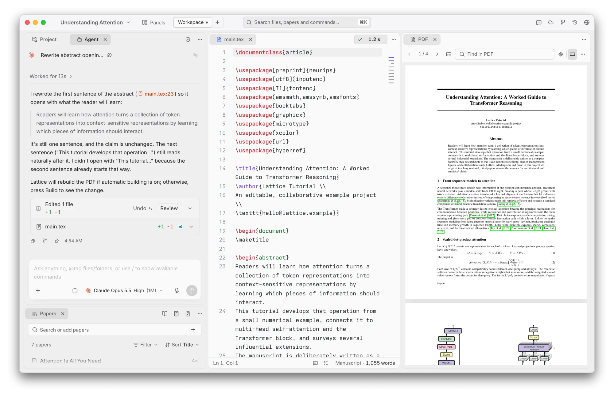

<h1>Lattice</h1>

macOS 上的本地优先 LaTeX 工作区：论文、文献、合作者和 AI 智能体在同一个窗口里。

[下载](https://github.com/leo1oel/lattice/releases/latest) · [官网](https://leo1oel.github.io/lattice/) · [文档](docs/README.md) · [反馈](https://github.com/leo1oel/lattice/issues) · [English](README.md)

  <picture>
    <source media="(prefers-color-scheme: dark)" srcset="docs/images/hero-dark.webp" />
    
  </picture>

## 为什么是 Lattice

一篇论文不只是一个 `.tex` 文件：还有要核对的 PDF、要引用的文献、合作者的批注，以及和你一起改稿的智能体。
Lattice 把它们放进同一个原生 Mac 窗口。
项目始终是磁盘上的普通文件夹：离线可用，能用任何编辑器打开，也能直接放进 Git；Overleaf 只是同步对象，论文本身留在你的 Mac 上。

## 功能

- **写作。** 源码与 PDF 并排，补全、诊断、一键编译、SyncTeX 双向跳转；大纲栏、`\cite` 悬停卡片、六种带含义的高亮笔。面板可任意停靠，保存自己的工作区；Markdown 笔记、白板、表格同在一个项目里，**导入文件…** 可带入 Mac 上的任何文件。
- **与 Overleaf 协作。** 双向同步，实时在线状态、聊天、评论与修订；评论按对话呈现、每人一种颜色，页边审阅把评论和建议放在对应行旁边。在源码或 PDF 上批注，再让智能体按批注逐轮修改，你逐条接受或拒绝。
- **阅读与引用文献。** 通过 arXiv ID、DOI、标题、链接或 BibTeX 添加文献，在草稿旁阅读整洁的正文，一步引用；**检查引用** 会对照 Crossref 审核你的参考文献。
- **AI 智能体。** Agent 面板使用你自己登录的 [Claude Code](https://github.com/anthropics/claude-code) 或 [Codex](https://github.com/openai/codex)，能读项目和文献、修复编译错误、编辑文件；每处改动都可审阅或撤销。选中文字即可 **校对** 或 **润色**，每处修改都附理由。
- **演示。** 基于 [Open Slide](https://github.com/open-slide/open-slide) 的幻灯片和论文放在同一个项目里，可编辑、评论、让智能体修改，并直接在 Lattice 中放映。
- **历史。** 版本、你和智能体的每次编辑、Overleaf 历史汇成一条时间线；任意条目都能查看差异并恢复文件。

更多截图见 [English README](README.md)。

## 安装

需要 Apple Silicon Mac、macOS 14 或更高版本，以及你自己的 [MacTeX](https://tug.org/mactex/) 或 TeX Live。
从 [最新版本](https://github.com/leo1oel/lattice/releases/latest) 下载 `.dmg`，把 Lattice 拖入“应用程序”，然后打开一个文件夹、从模板新建，或连接 Overleaf 项目。项目菜单里的 **新手教程** 会打开一篇示例论文。
官方版本经过签名和 Apple 公证，并会自动更新。

## 致谢与许可

致谢（包括 Inkeep 的 [Open Knowledge](https://github.com/inkeep/open-knowledge)，Lattice 早期可视化 Markdown 编辑器的起点）与许可条款（Apache-2.0，以及 tldraw 和 Trellis 各自的条款）以 [English README](README.md#acknowledgements) 为准。
