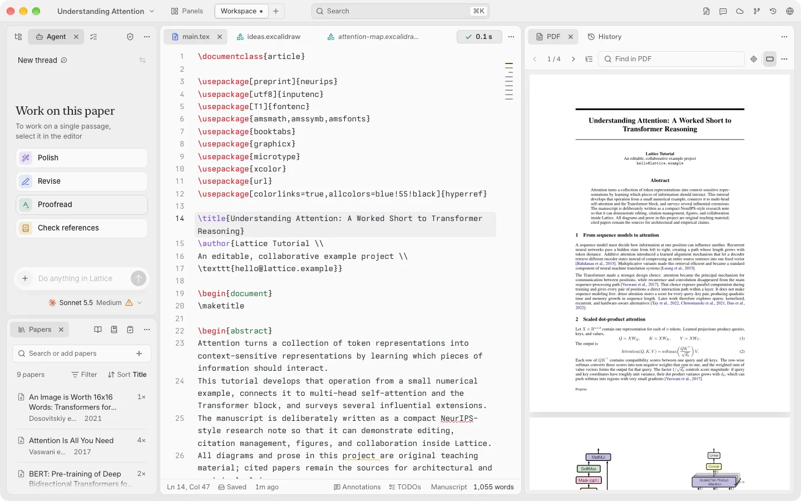

# The Agent

The Agent panel runs a coding agent that reads your project and papers, fixes build errors and edits files. Every change it makes shows as a diff you can review or undo, and lands in [History](history.md). Lattice includes no model or AI subscription of its own: you bring one.

## Connect an agent

Open the **Agent** panel (`⌘⌥3`, or the robot icon on the left). Then use one of:

- **Claude Code** or **Codex** on your Mac, signed in as you. Install the CLI, sign in once in Terminal (for example `claude auth login`), and pick it in the model menu under the message box.
- **Another agent CLI** you have installed, such as Cursor, OpenCode or Droid.
- **Your own API**: **Settings › Agent › Model endpoint** takes an OpenAI- or Anthropic-compatible address, a key (kept in your Keychain) and model names. Nothing else to install.

**Settings › Agent › Providers** sets the default provider and the models Lattice uses for its own small tasks (proofreading, commit messages, compile repair). **MCP** adds tools such as Zotero to the Agent; **Usage & limits** shows what you have used.

## Work with it

- Type what you want in the message box and press Return. Mention a file to point it there.
- **Polish**, **Revise**, **Proofread** and **Check references** start common tasks. To work on one passage, select it in the editor first.
- In the editor, select text to **Proofread** (`⌘⌥P`), **Polish** or **Rewrite…** it in place, with a reason for each edit.
- **Annotate** a passage (select it, choose **Annotate**, write what should change), then **Save and revise now**: the Agent proposes an edit for each annotation and you accept or reject it in place. **Revise from annotations** in the command palette does every open annotation in rounds.
- A failed build's **Ask the agent** sends that problem straight here.

Threads are kept per project; the clock next to the thread name lists earlier ones. The **×** on a thread archives it rather than deleting it: **Settings › Agent › Archived threads** lists archived threads, including ones archived after a while unused, and can restore one to the history or delete it for good.

In the native Lattice, the threads you had in the classic version show up as well. Each time its Agent starts, it adds the classic version's threads it doesn't have yet and says how many in a short notice. Continuing one picks up from its earlier messages.

## A window of its own

In the native Lattice, **Open in separate window** in the Agent panel's header moves the Agent into its own window, with the thread, your draft and a running reply intact. **Return to workspace**, the same command in the command palette, or closing the window puts it back. The window keeps its place and size for each project, and opens again with the project.
