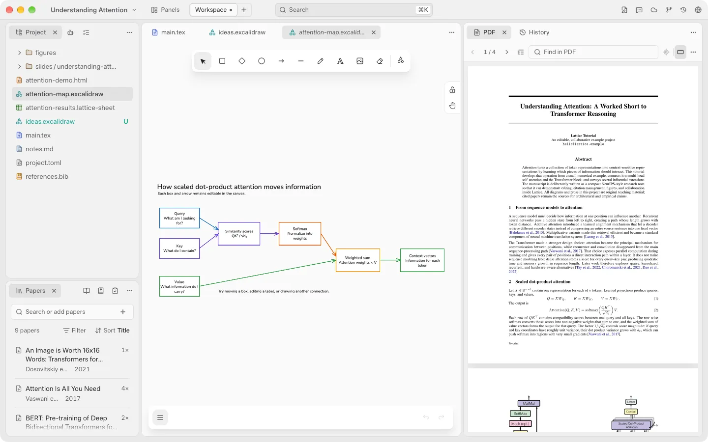

# Boards

A board is an [Excalidraw](https://excalidraw.com) whiteboard saved in your project as a `.excalidraw` file. Use it for figures you are still thinking through, diagrams to show co-authors, or notes beside the paper.

## Create a board

In the **Project** panel, right-click an empty area (or a folder) and choose **New file**, then name it with the `.excalidraw` ending, for example `ideas.excalidraw`. It opens as an empty board. An existing `.excalidraw` file from elsewhere opens the same way: use **Import files…** in the same menu.

## Draw

The toolbar at the top has selection, rectangle, diamond, ellipse, arrow, line, freehand pen, text, image and eraser. Arrows snap to shapes and stay attached when you move them. The lock keeps the current tool selected; the hand pans the canvas. Undo and redo are at the bottom right, and the menu at the bottom left has export and canvas options.

Boards save as you draw, appear in [History](history.md) like any other file, and sync to Overleaf as ordinary files. The Agent can read and edit them too.
