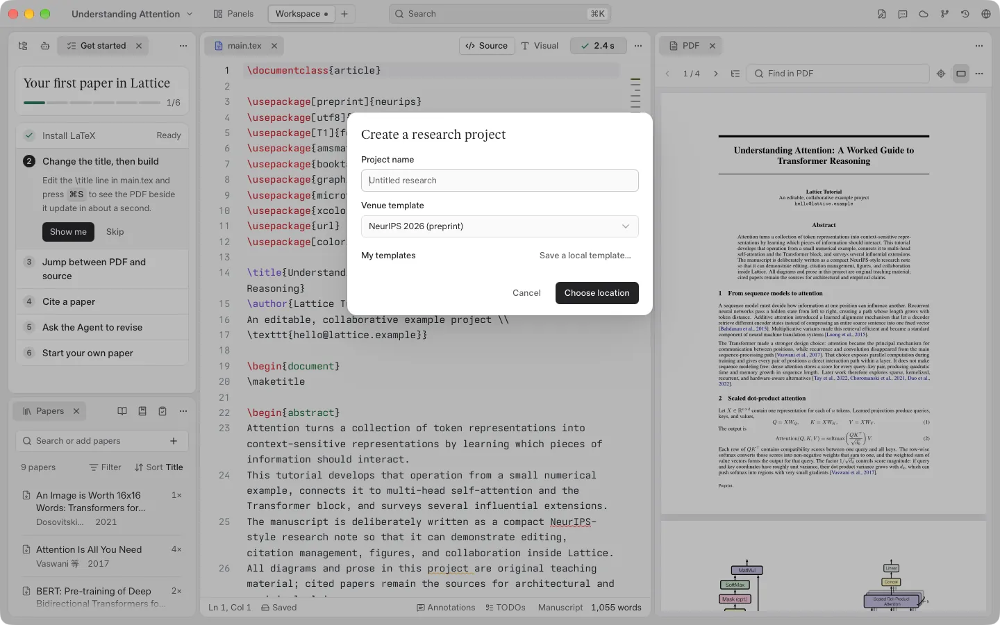
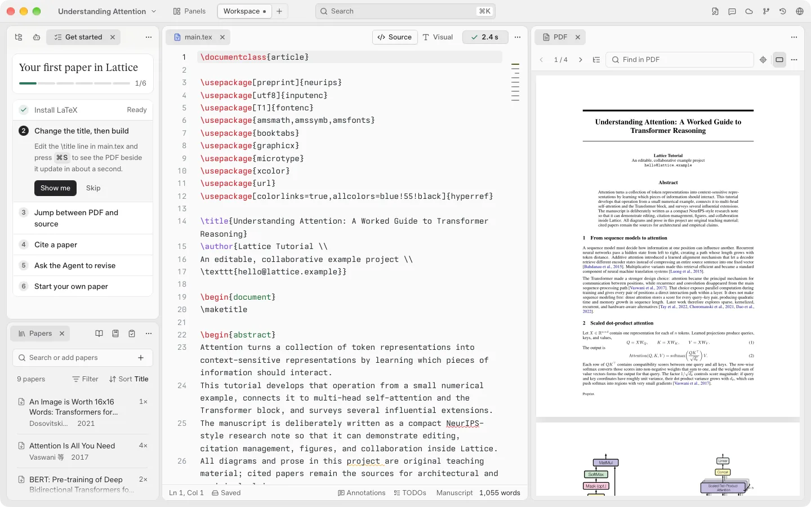

# Getting started

## Install Lattice

1. Download the `.dmg` from the [latest release](https://github.com/leo1oel/lattice/releases/latest) and drag Lattice into Applications. On an Intel Mac, take the file ending in `_x64.dmg`. With Homebrew: `brew install --cask lattice`.
2. Open Lattice. It updates itself: when a new version is ready, **Lattice › Restart to Update…** installs it. You can change this in **Settings › Editor & builds › App updates**.

Lattice needs macOS 14 or later. Linux (AppImage) and Windows builds are experimental and have no Agent.

## Set up TeX

Lattice builds PDFs with your own TeX installation (MacTeX or TeX Live). If you have none, Lattice offers to install **BasicTeX** for you: it is the first step of the Get started checklist, and a build that finds no TeX offers it too. A missing LaTeX package found during a build can also be installed from the build problem itself.

To check your setup at any time, open **Settings › TeX doctor**. It lists every tool a build uses and what the open project needs (its root document, bibliography, venue packages and fonts). **Ready to compile** means you are set. If something is red, **Install required tools** installs it; adding papers and looking up citations need a small Python tool (`uv`), which the same button installs.

## Open or create a project

The project menu (the project name at the top left of the window) and the **File** menu have the same actions:

- **Open another folder** (`⌘O`): any folder with a `.tex` file. Lattice works on it in place.
- **New project** (`⌘⇧N`): name it, pick a venue template (NeurIPS, ICML, ICLR, ACL, CVPR, AAAI or a thesis class) or one of your own saved templates, then **Choose location**.
- **Clone repository…**: a Git repository from GitHub or elsewhere.
- **Open from Overleaf**: see [Overleaf sync](overleaf.md).
- **Import Overleaf ZIP…**: a project downloaded from Overleaf as a ZIP.

Recent projects are in **File › Open Recent**. A window can hold several projects as tabs in the title bar.

## The Get started checklist

**Guided tutorial** in the project menu opens a sample paper beside **Get started**, a six-step checklist: install LaTeX, change the title and build, jump between PDF and source, cite a paper, ask the Agent to revise a paragraph, and start your own paper. Each step has **Show me**, and steps you do on your own tick themselves. You can reopen the checklist from **Panels › Get started**.

