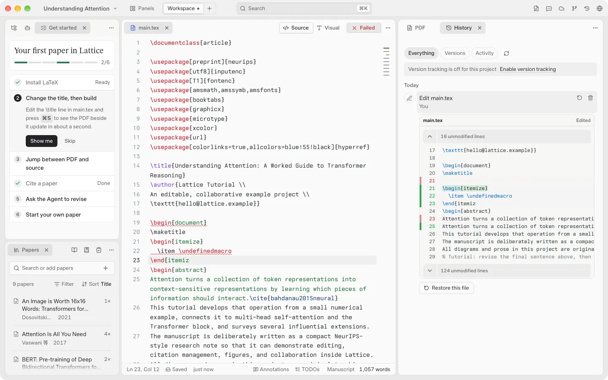
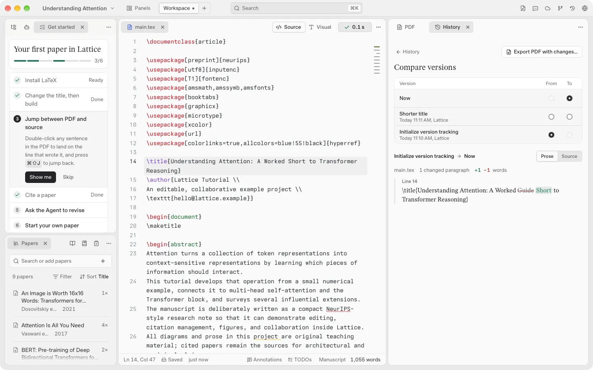

# History and Compare versions

Lattice keeps a history of every change to your project, whoever made it: you, the Agent, or a co-author on Overleaf. Open it with the **History** button in the title bar (the clock), or **Panels › History**.

## Undo a change

**Everything** lists changes newest first. Click one to see its diff, then **Restore this file** to put the file back as it was before that change. A restore is itself a new entry, so it can be undone too.

**Activity** shows the same timeline grouped by what happened, such as builds and Agent turns.

## Save versions

Named versions use Git. The first time, **Versions** offers **Enable version tracking**, which makes the project a Git repository (an existing repository is used as it is). Then:

- **Save version** records the project now, with a name you give it.
- Each version can be restored, or compared with now.

## Compare versions

In **Versions**, choose **Compare…**, then pick a **From** and a **To** version (**Now** is the project as it is on disk). Lattice lists every changed file. **Prose** shows changed words, which is easier to read for text; **Source** shows the line diff.

**Export PDF with changes…** writes a PDF with the differences marked, through `latexdiff` from your TeX installation. With BasicTeX you may need `sudo tlmgr install latexdiff` first.

## Track changes

**Track changes** turns on review mode: your edits from then on are marked in the source as you type, and you accept or reject each one, or all at once. It works without Overleaf.
