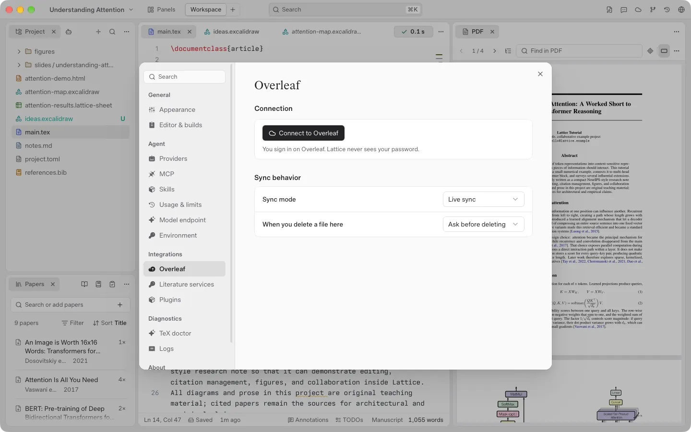

# Overleaf sync

Lattice syncs with Overleaf both ways. Your co-authors keep working on Overleaf and don't need Lattice; their edits, comments, chat and tracked changes show up in Lattice as they happen.

## Connect

Open **Settings › Overleaf** and choose **Connect to Overleaf**. You sign in on Overleaf's own page; Lattice never sees your password.

## Open an Overleaf project

1. Choose **Open from Overleaf** in the project menu or the **File** menu, or click the cloud button in the title bar.
2. Search your projects, or paste a project's link. Projects shared with you as invitations are listed too; accept the invitation on Overleaf first.
3. Choose **Download to** for where the local copy goes, then open the project.

Lattice downloads it into an ordinary folder and keeps that folder linked. If you already have a local copy, **Link this folder** connects it instead of downloading again.

## Put a local project on Overleaf

With the project open, open the same Overleaf panel and choose **Upload this project to Overleaf**, give it a name, then **Upload and connect**.

## How sync behaves

Set in **Settings › Overleaf**:

- **Sync mode**: **Live sync** sends and receives edits as you type. **Manual** syncs only when you choose **Sync now**.
- **When you delete a file here**: **Ask before deleting** (the default), **Delete on Overleaf too**, or **Keep it on Overleaf**.

When the same file changed on both sides between syncs, Lattice merges the two against the last synced version: prose (.tex, Markdown, text) sentence by sentence, other text files line by line. Edits to different sentences, even in the same paragraph, both survive. Only a spot you both rewrote is marked, in the file itself, with your text and Overleaf's tinted side by side and **Keep mine**, **Keep theirs** and **Keep both** on it; the sync opens the first marked file there. The text from before the merge is kept under `.research/overleaf-conflicts/`, which never syncs.

When a figure or another binary file changed on both sides, the newer copy stays and the other is set aside. A notice says whose copy stayed, with **Use mine** or **Use Overleaf's** to swap.

The PDF that a main document builds never syncs, for every main document in the project. A PDF your source includes as a figure still syncs.

Overleaf refuses some file names, such as one with a backslash or an asterisk, or one starting or ending with a space. Such a file stays on this Mac and everything else keeps syncing; a warning names the file and the rule it breaks. Rename it to sync it. Uploading a project with such a name to Overleaf asks you to rename them first.

Comments and suggestions from Overleaf appear in the margin of the source and in the Overleaf panel (Comments, Suggestions and Chat). **View › Margin Review** chooses how much the margin shows.
