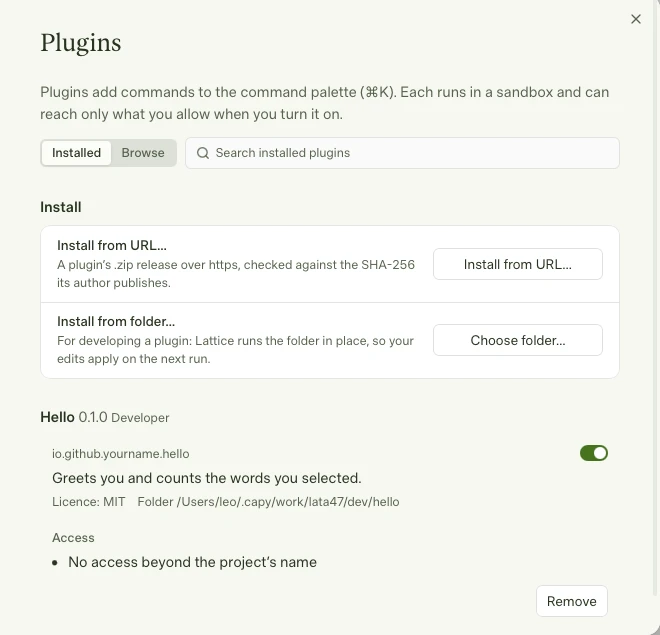
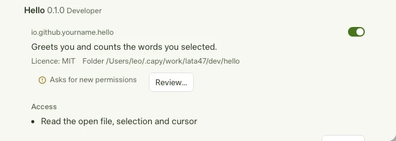
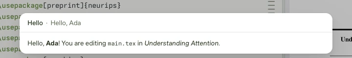

# Your first plugin

A plugin adds commands to the command palette (`⌘K`). It is a folder holding a manifest, `lattice-plugin.toml`, and a Node script. When you run one of its commands, Lattice starts the script in a sandbox, sends it the command over stdin, and shows what it answers: a message, a list to pick from, or problems in your files. A plugin never draws its own UI or writes files; it asks Lattice to, and the writer confirms.

This page builds a plugin called Hello, step by step. [Plugin manifest and API](plugin-reference.md) is the reference for everything it uses, and [Publishing a plugin](plugin-publishing.md) takes it to the plugin market.

You need:

- a Mac with Lattice 0.18 or later. Plugins run only on macOS for now, and Lattice runs them with the Node it ships, so the people who install your plugin need nothing else;
- Node 22 or later in Terminal (`node --version`), to try the plugin outside Lattice and to pack it.

## 1. Make the folder

```sh
mkdir hello && cd hello
curl -fsSLO https://raw.githubusercontent.com/leo1oel/lattice/main/plugin-sdk/lattice-plugin.mjs
```

`lattice-plugin.mjs` is the SDK: one MIT-licensed file with no dependencies that speaks the protocol for you. It lives in your folder because a plugin can read only its own folder. TypeScript types for it are in [plugin-sdk](https://github.com/leo1oel/lattice/tree/main/plugin-sdk) (`index.d.ts` and `api.d.ts`).

## 2. Write the manifest

Create `lattice-plugin.toml`:

```toml
schema = 1
id = "io.github.yourname.hello"
name = "Hello"
version = "0.1.0"
api = 1
license = "MIT"
description = "Greets you and counts the words you selected."
runtime = "node"
main = "main.mjs"

[[commands]]
id = "greet"
title = "Say hello"
description = "Greets you by name."
input = { kind = "text", placeholder = "Your name" }
```

- `id` is the plugin's identity for good: reverse-domain and lower case, under a name you own, such as `io.github.<your GitHub name>.<plugin>`. `app.lattice.*` is reserved for Lattice's own plugins.
- `api = 1` is the lowest plugin API level the plugin needs. Lattice 0.18 speaks level 1.
- Each `[[commands]]` entry becomes "Hello: <title>" in the palette. `input = { kind = "text" }` asks the writer to type something before the command runs.

## 3. Write the command

Create `main.mjs`:

```js
import { definePlugin, PluginError } from "./lattice-plugin.mjs";

definePlugin({
  commands: {
    async greet({ input, context }) {
      const name = input?.trim();
      if (!name) throw new PluginError("Type your name first.");
      return {
        kind: "message",
        summary: `Hello, ${name}`,
        markdown: `Hello, **${name}**! This is *${context.project.name}*.`,
      };
    },
  },
});
```

Each key under `commands` is a command id from the manifest. A handler gets `{ input, context, host, signal }` and returns a result. Throwing `PluginError` shows its message to the writer instead.

## 4. Try it in Terminal

Lattice talks to a plugin in JSON-RPC, one JSON message per line. You can play Lattice's part yourself:

```sh
(
  echo '{"jsonrpc":"2.0","id":1,"method":"initialize","params":{"hostApiLevel":1,"hostApiCompat":1}}'
  echo '{"jsonrpc":"2.0","id":2,"method":"command/run","params":{"command":"greet","input":"Ada","context":{"project":{"name":"thesis"}}}}'
  sleep 1
) | node main.mjs
```

The plugin answers both messages:

```text
{"jsonrpc":"2.0","id":1,"result":{"apiLevel":1}}
{"jsonrpc":"2.0","id":2,"result":{"kind":"message","summary":"Hello, Ada","markdown":"Hello, **Ada**! This is *thesis*."}}
```

With `"input":""` it answers `{"code":-32000,"message":"Type your name first."}` instead. The `sleep 1` keeps stdin open while the plugin answers: the SDK exits when stdin closes, because that is how Lattice ends a run.

## 5. Install it from its folder

1. Open **Settings › Plugins**. Next to **Install from folder…**, choose **Choose folder…** and pick the `hello` folder.
2. Hello appears under **Installed**, marked **Developer** and turned off. Turn it on: Lattice asks "Turn on Hello?" and lists what it will be able to do, here "No access beyond the project’s name". Choose **Turn on**.
3. Open a project, press `⌘K`, type "hello" and choose **Hello: Say hello**. Type your name and press Return. The palette shows "Hello, **Ada**! This is *Understanding Attention*."



Lattice runs the folder in place and reads it again on every run, so after you save `main.mjs` or the manifest, just run the command again.

## 6. Read the project

Without permissions, a plugin learns only the project's name. To read more, it asks in the manifest, and the writer agrees when turning it on. Replace `lattice-plugin.toml` with this version, which adds a `[permissions]` table and a second command:

```toml
schema = 1
id = "io.github.yourname.hello"
name = "Hello"
version = "0.1.0"
api = 1
license = "MIT"
description = "Greets you and counts the words you selected."
runtime = "node"
main = "main.mjs"

[permissions]
project-read = ["context"]

[[commands]]
id = "greet"
title = "Say hello"
description = "Greets you by name."
input = { kind = "text", placeholder = "Your name" }

[[commands]]
id = "count"
title = "Count words in the selection"
```

`project-read = ["context"]` gives the plugin the main document, the active file, the bibliography paths, the selection (up to 12,000 characters) and the cursor. Then replace `main.mjs` to use them:

```js
import { definePlugin, PluginError } from "./lattice-plugin.mjs";

definePlugin({
  commands: {
    async greet({ input, context, host }) {
      const name = input?.trim();
      if (!name) throw new PluginError("Type your name first.");
      host.log("info", `greeting ${name}`);
      const file = context.project.activeFile ?? "no file";
      return {
        kind: "message",
        summary: `Hello, ${name}`,
        markdown: `Hello, **${name}**! You are editing \`${file}\` in *${context.project.name}*.`,
      };
    },

    async count({ context }) {
      const selection = context.selection;
      if (!selection?.text) throw new PluginError("Select some text first.");
      const words = selection.text.split(/\s+/).filter(Boolean).length;
      return {
        kind: "items",
        summary: `${words} words selected`,
        items: [
          {
            id: "words",
            title: `${words} words`,
            subtitle: `${selection.file}, line ${selection.from.line}`,
            actions: [
              { type: "copy", title: "Copy the count", text: String(words) },
              { type: "reveal", title: "Show the selection", file: selection.file, line: selection.from.line },
            ],
          },
        ],
      };
    },
  },
});
```

`count` returns a list instead of a message. Each item carries actions, verbs Lattice performs for the plugin: the first runs on Return, here copying the count.

Try `count` with a selection:

```sh
(
  echo '{"jsonrpc":"2.0","id":1,"method":"initialize","params":{"hostApiLevel":1,"hostApiCompat":1}}'
  echo '{"jsonrpc":"2.0","id":2,"method":"command/run","params":{"command":"count","context":{"project":{"name":"thesis"},"selection":{"file":"main.tex","text":"Attention is all you need","from":{"line":12,"column":1},"to":{"line":12,"column":26}}}}}'
  sleep 1
) | node main.mjs
```

Back in Lattice, run **Hello: Say hello** again. It doesn't run: the plugin now asks for more than you allowed, so the palette says "This plugin asks for new permissions. Review them in Settings › Plugins." Choose **Open Settings**. Hello's card says **Asks for new permissions**; choose **Review…**, check the list, and choose **Turn on**. Every installed plugin works this way, so a plugin can never gain access without the writer seeing it.



Now **Hello: Say hello** names the file you're editing, and **Hello: Count words in the selection** counts what you selected; Return copies the count.



## 7. Read its logs

- **`host.log(level, message)`** writes to Lattice's log, `~/Library/Logs/app.leo1oel.researchwriter/lattice.log`, as a line tagged `lattice::plugins` with your plugin's id. Follow it while you work:

  ```sh
  tail -f ~/Library/Logs/app.leo1oel.researchwriter/lattice.log | grep --line-buffered lattice::plugins
  ```

  Running **Hello: Say hello** adds a line ending in `io.github.yourname.hello: greeting Ada`. **Settings › Logs › Open log folder** opens the folder.
- **`console.log` and stderr.** The SDK sends `console.log` to stderr, because stdout carries the protocol. When the plugin stops without answering, Lattice shows the end of its stderr in the palette. Otherwise stderr goes to the log only at the `debug` level, so start Lattice from Terminal to see it:

  ```sh
  LATTICE_LOG=debug /Applications/Lattice.app/Contents/MacOS/research-writer
  ```

- **Never print to stdout yourself.** A line on stdout that isn't JSON-RPC ends the run, and the palette says “The plugin sent something Lattice couldn’t read”.

## What's next

- [Plugin manifest and API](plugin-reference.md): every permission, host call, result and action.
- [Publishing a plugin](plugin-publishing.md): pack Hello, list it in the plugin market, and ship updates.
- Two real plugins to copy: [bib-check](https://github.com/leo1oel/lattice/tree/main/examples/plugins/bib-check) (diagnostics for `.bib` files) and [zotero-search](https://github.com/leo1oel/lattice/tree/main/examples/plugins/zotero-search) (search Zotero and cite).
