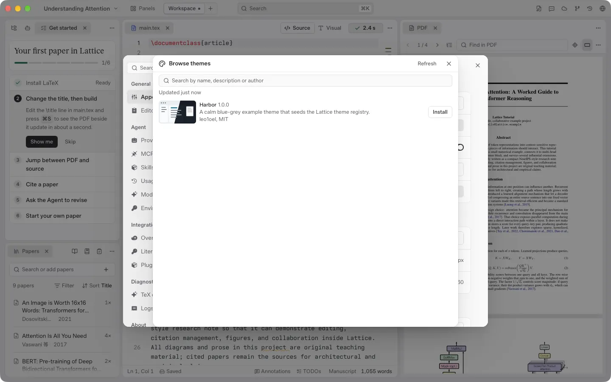
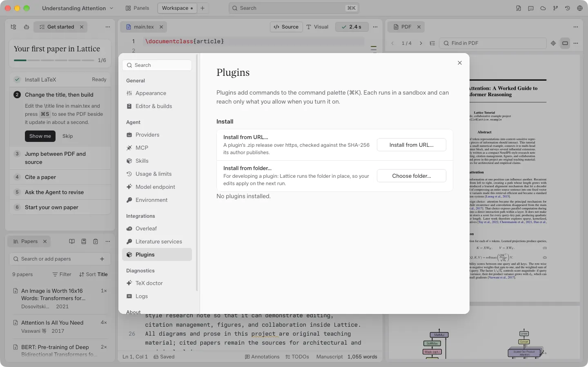

# Plugins and themes

## Themes

Open **Settings › Appearance**. Under **Theme** you can pick a built-in theme, light or dark, or:

- **Browse themes…**: themes others have published. Choose **Install** on one, then pick it from your themes.
- **Install from file…**: a theme file you were given.
- **Show themes folder**: where your installed theme files live.

The editor's syntax colors are set separately under **Code theme** on the same page.

## Plugins

Plugins add commands to the command palette (`⌘K`). Each runs in a sandbox and can reach only what you allow when you turn it on.

Open **Settings › Plugins**. The page has two views, **Installed** and **Browse**, and one search field for whichever view is showing.

### Browse the plugin market

**Browse** lists the plugins in the Lattice plugin market. The list is signed, so Lattice refuses one that has been tampered with, and when you're offline it shows the last list it verified. Sort by most downloaded, recently updated or name, and choose **Refresh** to fetch the list again.

Choose a plugin to see its details: who made it, its version and licence, what **This plugin can** do and what it can't, and the commands it adds. Then choose:

- **Install and turn on**: installs the plugin and turns it on.
- **Install only**: installs it turned off, to turn on later.

### Installed plugins

Each installed plugin shows where it came from: **Reviewed** for a plugin from the market, **Not reviewed** for one installed from a URL, **Developer** for a folder. Turn a plugin on or off with its switch; turning it on lists the permissions it asks for. Remove a plugin from its card.

When an update is available, the card says so. **Update all** applies every update that asks for nothing new. An update that asks for more than you allowed waits on its own card and lists only what is new, with **Allow and update** or keep the version you have.

If a plugin is withdrawn from the market, Lattice turns it off and says why on its card (**Learn more**). Plugins run on macOS only for now.

### Install a plugin yourself

- **Install from URL…**: a plugin's `.zip` release over `https`, checked against the SHA-256 its author publishes.
- **Install from folder…**: for developing a plugin; Lattice runs the folder in place, so your edits apply on the next run.

Writing a plugin? See the [plugin developer docs](https://github.com/leo1oel/lattice/blob/main/docs/plugins.md).
