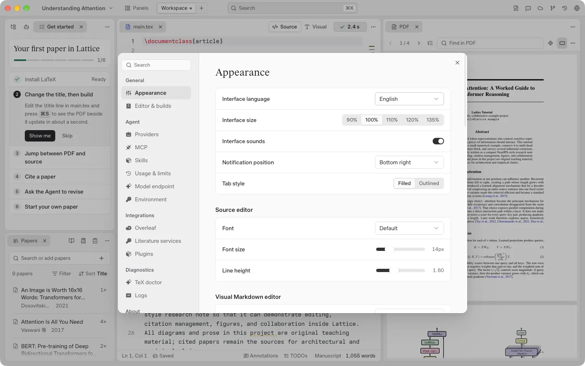
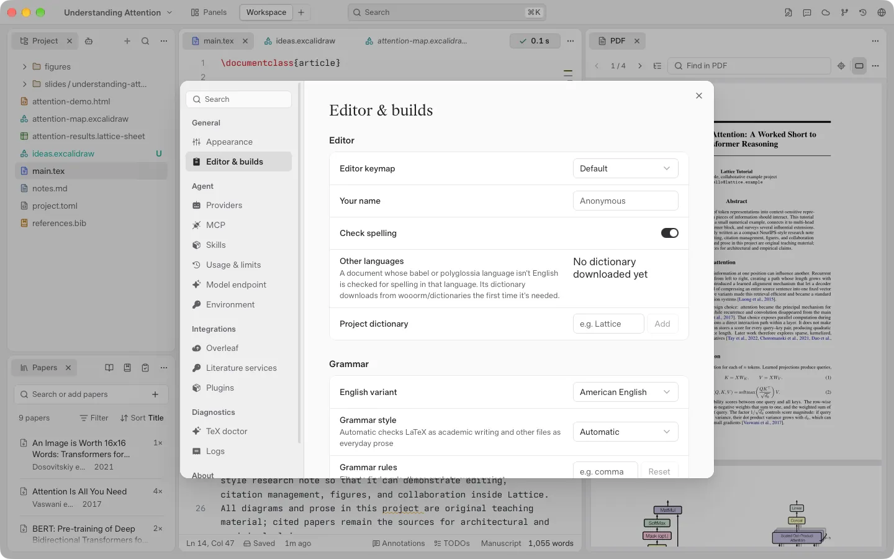
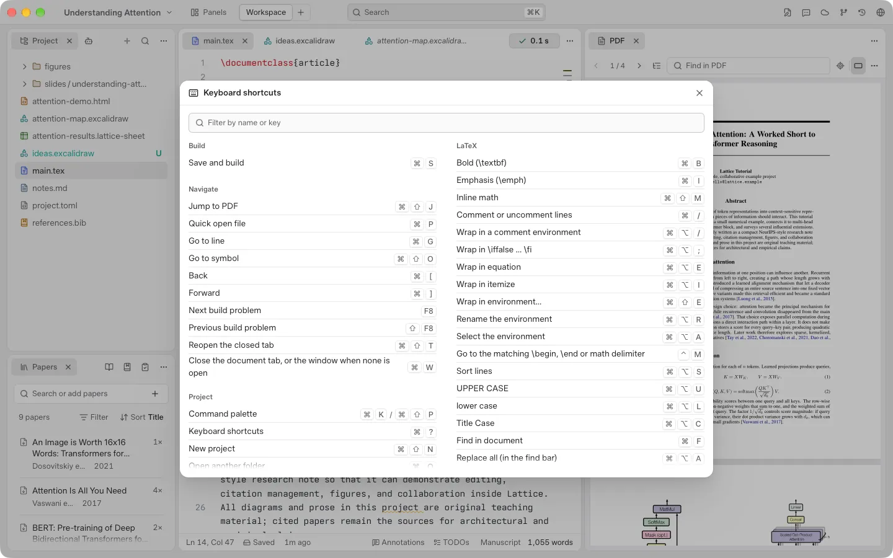

# Settings and shortcuts

## Settings

Open **Lattice › Settings…** (`⌘,`). The search box at the top finds any setting by name.

| Section | What's there |
| --- | --- |
| **Appearance** | Interface language (English or 简体中文), interface size, sounds, notification position, tab style, editor fonts, theme and code theme, title bar tools. |
| **Editor & builds** | Editor keymap (default, Vim or Emacs), your name, spelling and grammar (on an Apple silicon Mac, spelling only, with macOS's checker), automatic build, auxiliary files, compile engine, shell escape, app updates. |
| **Agent** | Providers, MCP, Skills, Usage & limits, Model endpoint, Environment. See [The Agent](agent.md). |
| **Integrations** | Overleaf, Literature services (keys for literature search), Plugins. |
| **Diagnostics** | TeX doctor, Logs. |

`⌘+`, `⌘−` and `⌘0` (or **View › Bigger / Smaller / Actual Size**) change the interface size for the moment.

## Shortcuts

Press `⌘?` (`⌘⇧/`) for **Keyboard shortcuts**, the full list, with a filter by name or key. Shortcuts follow the commands you have, so the list is always current. The ones worth learning first:

| Keys | Action |
| --- | --- |
| `⌘K` | Command palette: every command by name |
| `⌘S` | Save and build |
| `⌘P` | Quick open a file |
| `⌘⇧K` / `⌘⇧L` | Insert citation / reference |
| `⌘⇧J` | Jump to PDF |
| `F8` / `⇧F8` | Next / previous build problem |
| `⌘⇧F` | Find in project |
| `⌘⌥1`, `⌘⌥2`, `⌘⌥3` | Project, Papers, Agent panel |
| `⌘1` … `⌘9` | Switch workspace |
| `⌘⇧D` | Focus mode |
| `⌘W` / `⌘⇧T` | Close tab / reopen it |

To use Vim or Emacs keys in the editor, set **Settings › Editor & builds › Editor keymap**.
