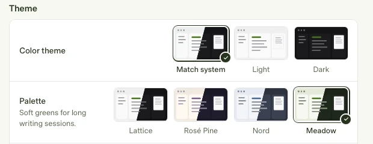

# Making a theme

A theme recolors Lattice. It is data, not code: one `.lattice-theme.json` file that gives colors to Lattice's design roles, such as the window, the editor, text and the accent. Lattice works out every other color (hover, pressed, selection washes) from those, so a theme stays consistent in every state. A theme can't change sizes, fonts or behavior and can't run anything, so installing one asks for no permission and works on every platform.

## 1. Write the file

Create `meadow.lattice-theme.json`:

```json
{
  "$schema": "https://leo1oel.github.io/lattice-plugins/schema/theme-1.json",
  "schema": 1,
  "id": "io.github.yourname.meadow",
  "name": "Meadow",
  "version": "1.0.0",
  "author": "Your Name",
  "license": "MIT",
  "description": "Soft greens for long writing sessions.",
  "variants": [
    {
      "id": "day",
      "name": "Meadow Day",
      "appearance": "light",
      "colors": {
        "window": "#eef2e6",
        "chrome": "#e4eadb",
        "panel": "#f6f8f1",
        "editor": "#fbfcf8",
        "text": "#27331f",
        "text-secondary": "#56624c",
        "line": "#27331f1f",
        "accent": "#4f7a28"
      },
      "syntax": { "keyword": "#4f7a28", "comment": "#6f7a66" }
    },
    {
      "id": "night",
      "name": "Meadow Night",
      "appearance": "dark",
      "colors": {
        "window": "#161b13",
        "chrome": "#1c2318",
        "panel": "#20281b",
        "editor": "#1a2016",
        "text": "#e3ead8",
        "text-secondary": "#a9b49c",
        "line": "#e3ead81f",
        "accent": "#9cc56b"
      }
    }
  ]
}
```

The `$schema` line lets editors such as VS Code check the file and complete role names as you type.

- **`id`** is reverse-domain, lower case and yours, like a plugin's. `app.lattice.*` belongs to the themes that ship with Lattice.
- **Variants:** one to eight, each `light` or `dark`. Lattice uses the first variant that matches the window's appearance; with only a dark variant, the light appearance stays Lattice's own.
- **Colors are literal `#RRGGBB` or `#RRGGBBAA`.** No names, `var()` or other functions. Lines are usually translucent, as above.
- **Every role is optional.** A role you leave out keeps Lattice's color for that appearance, so a theme can be as small as two surfaces and an accent.
- An unknown role is an error. The file may be at most 256 KiB.

## The roles

| Section | Roles |
|---|---|
| `colors`, surfaces | `window`, `chrome`, `panel`, `raised`, `input`, `editor`, `pdf-ground` |
| `colors`, text | `text`, `text-secondary` |
| `colors`, lines | `line`, `line-strong` |
| `colors`, accent | `accent`, `focus`, `selection` |
| `colors`, status | `danger`, `success`, `warning`, `info`, `annotation` |
| `syntax` | the editor's 16 token colors, such as `keyword`, `command` and `comment` |
| `terminal` | `black` … `white` and `bright-black` … `bright-white` |

Lattice keeps text readable: text, status and syntax colors that don't reach a 4.5:1 contrast on their surfaces are moved, keeping their hue, until they do, and the accent is held to 4.6:1. A theme that only reads after heavy correction will look off, so check your colors yourself. The full list of roles is in [docs/themes.md](https://github.com/leo1oel/lattice/blob/main/docs/themes.md#roles) and the [JSON Schema](https://github.com/leo1oel/lattice/blob/main/design-system/themes/theme-1.schema.json).

## 2. Try it in Lattice

1. Open **Settings › Appearance**. Under **Theme**, next to **Theme files**, choose **Install from file…** and pick `meadow.lattice-theme.json`.
2. Lattice installs it and chooses it: Meadow appears under **Palette**, checked, with its description. Switch **Color theme** between **Light** and **Dark** to see both variants.

Lattice checks the file when you install it and says what is wrong, such as an unknown role. It keeps a copy, so after you edit the file, install it again to see the change.



## 3. Publish it

Themes go through the same registry as plugins, with a smaller entry. The registry's addresses are listed under [Registry addresses](plugin-publishing.md#registry-addresses).

1. Put the theme file and a licence in a public GitHub repository, here `https://github.com/yourname/lattice-theme-meadow`, and tag the commit:

   ```sh
   git tag v1.0.0
   git push origin v1.0.0
   ```

2. Hash the file as committed. A theme isn't packed; the hash is the file's own:

   ```sh
   shasum -a 256 meadow.lattice-theme.json
   ```

3. In a fork of the registry, add `themes/<id>/entry.json`, here `themes/io.github.yourname.meadow/entry.json`:

   ```json
   {
     "id": "io.github.yourname.meadow",
     "version": "1.0.0",
     "repository": "https://github.com/yourname/lattice-theme-meadow",
     "tag": "v1.0.0",
     "commit": "<the full 40-character sha the tag points at>",
     "path": "meadow.lattice-theme.json",
     "sha256": "<what shasum printed>"
   }
   ```

   `id` and `version` equal the theme file's own, the folder name equals `id`, and `path` is the file inside the repository.

4. Run `npm ci` and `node scripts/validate.mjs --base origin/main` in the fork, as for [a plugin](plugin-publishing.md#3-add-the-entry). A new theme prints `ok   themes/io.github.yourname.meadow/entry.json` and `note: new theme: needs a human review (first submission)`.
5. Open the pull request and fill in the theme half of its checklist.

CI fetches only your tag, requires it to point at `commit`, reads the file at `path` from that commit (a regular file of at most 256 KiB), checks its SHA-256, validates it against the schema, and checks that its `id` and `version` match the entry and its variant ids are unique.

A reviewer then asks:

1. Is the id or name impersonating someone?
2. Is the description accurate, the licence present, and the repository real and public? A ported palette credits its original author and keeps its licence.
3. Is it readable? A theme that only works after Lattice's contrast correction is rejected.
4. Does it stay data? No fonts, no images, nothing outside the schema.

Once merged, the theme is signed and published with the next index, like a plugin (see [Signing](plugin-publishing.md#6-signing)), and it appears in **Settings › Appearance › Browse themes…**. Its tile there is painted from the index, so nothing downloads before someone chooses **Install**.

## Updates and the kill switch

To update a theme, raise `version` in the file, tag the new commit, and change `version`, `tag`, `commit` and `sha256` in your entry. Versions only go up. People who installed it from **Browse themes** are offered the update, which keeps their choice of theme.

The registry's [kill switch](plugin-publishing.md#the-kill-switch) covers themes too. When a version someone has chosen is blocked with `"disable"`, Lattice draws its own colors instead, keeps the choice stored, and says "<name> was turned off: <reason>" in **Settings › Appearance**. A `"warn"` entry leaves the theme applied and shows its warning there. Themes installed from a file are never blocked.
