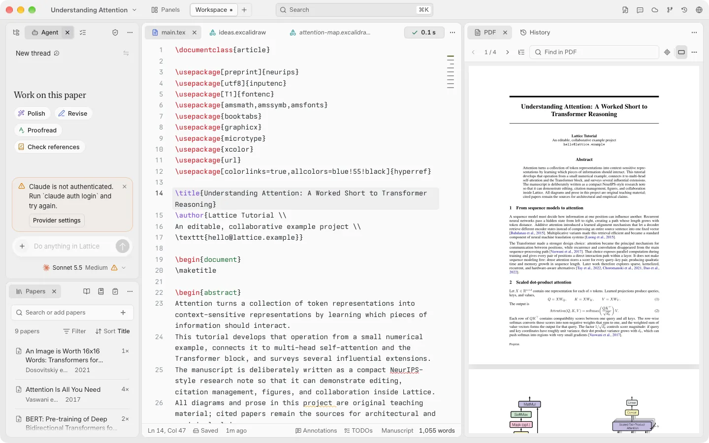

# Troubleshooting

**The build fails and I don't see why.** Read the first problem in the build panel; later ones often follow from it. Open **Log** for LaTeX's own words. Then try **Clean rebuild** from the command palette (`⌘K`). See [Building](building.md).

**"Missing LaTeX dependency" or a package not found.** BasicTeX doesn't include every package Overleaf has. Use the problem's install button, or **Settings › TeX doctor › Install required tools**.

**A build can't find LaTeX at all.** Open **Settings › TeX doctor**. If it lists missing tools, install TeX from the Get started checklist or from [MacTeX](https://tug.org/mactex/), then reopen the project.

**Adding papers or looking up citations doesn't work.** These need the small `uv` tool. **Settings › TeX doctor** shows whether `uv` and `uvx` are there; **Install required tools** installs them.

**The Agent says it isn't signed in.** The panel shows which provider is missing a sign-in, for example "Claude is not authenticated". Sign in once in Terminal (`claude auth login` for Claude Code), then try again, or pick another provider in **Provider settings**.

**Overleaf stopped syncing.** Open **Settings › Overleaf**. If your session expired, choose **Reconnect to Overleaf**. A file with conflict markers pauses sync for that file until you resolve them.

**A panel is gone.** **Panels › Reset layout** brings every panel back. To undo a deleted workspace, use **Undo** in the notice right away.

**I lost text.** Open [History](history.md): every save, every Agent edit and every Overleaf change is there, and **Restore this file** puts a file back.

**Something else is wrong.** **Help › Report a Problem…** saves a redacted log you can attach to an issue, and opens [GitHub Issues](https://github.com/lattice-writer/lattice/issues). **Settings › Logs** shows the log in the app.
