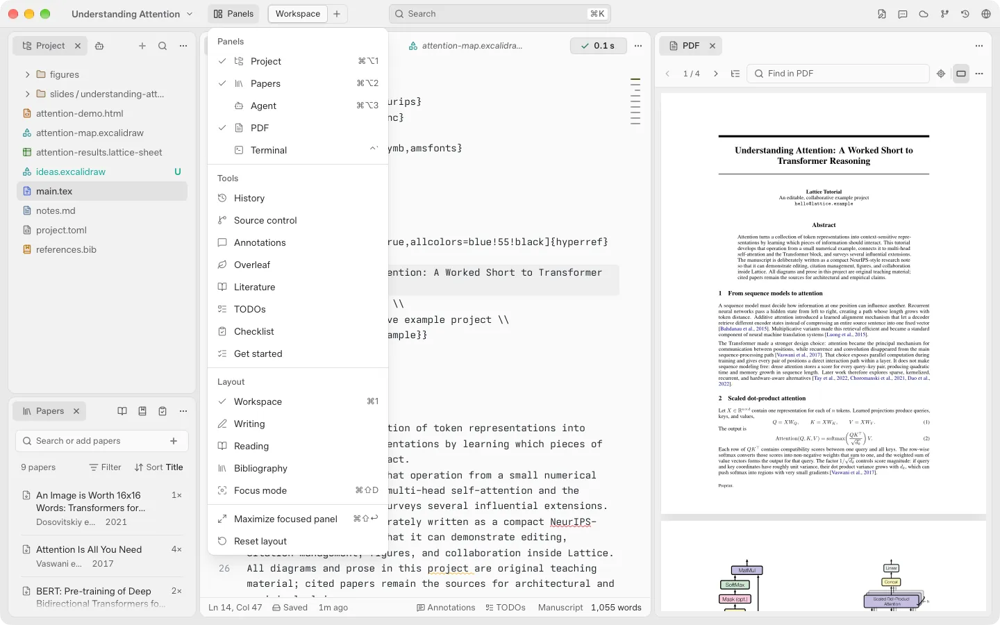
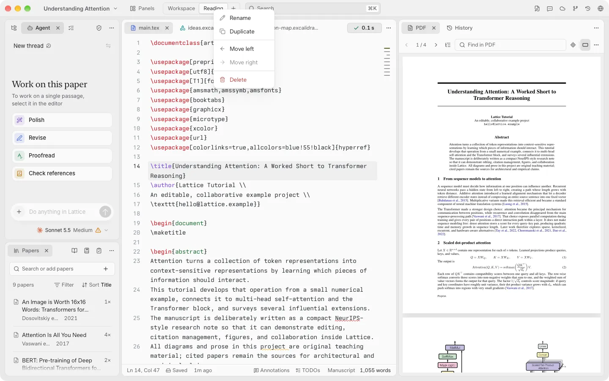

# Panels and workspaces

## Panels

Everything in the window is a panel: Project, Papers, Agent, PDF, Terminal, and tools such as History, Annotations, Overleaf, Literature, TODOs and Checklist. The **Panels** menu in the title bar shows or hides each one.

- Drag a panel's tab to dock it anywhere: beside, above or below another panel, or as a tab in its group.
- `⌘⌥1` Project, `⌘⌥2` Papers, `⌘⌥3` Agent, `` ⌃` `` Terminal show or hide those panels.
- `⌘⇧↩` maximizes the focused panel and restores the layout again.
- **Focus mode** (`⌘⇧D`) hides everything but the editor.
- **Reset layout** in the Panels menu brings back any panel you closed.

The Panels menu also has three ready-made layouts: **Writing**, **Reading** and **Bibliography**.

## Workspaces

A workspace is a saved arrangement of panels. They sit as tabs in the title bar, and `⌘1` to `⌘9` switch between them.

- **Create**: click **+** next to the workspace tabs. The new workspace starts from the layout on screen; type its name and press Return.
- **Save changes**: when you rearrange panels, the workspace tab shows a dot. Right-click the tab and choose **Save to workspace**, or **Revert to saved**.
- **Rename**: double-click the tab, or press F2.
- **Reorder**: drag the tab, or use **Move left** and **Move right**.

### Delete a workspace

Right-click the workspace's tab and choose **Delete**. If right-clicking doesn't open the menu (some trackpad settings), select the tab and press `⇧F10`. The deleted workspace can be brought back with **Undo** in the notice that appears. **Delete** is unavailable while it is the only workspace.

When the window is too narrow for tabs, the workspaces fold into one menu with the same actions.
