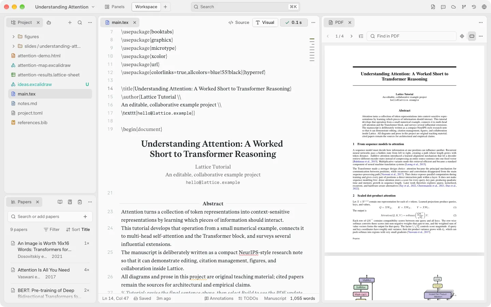
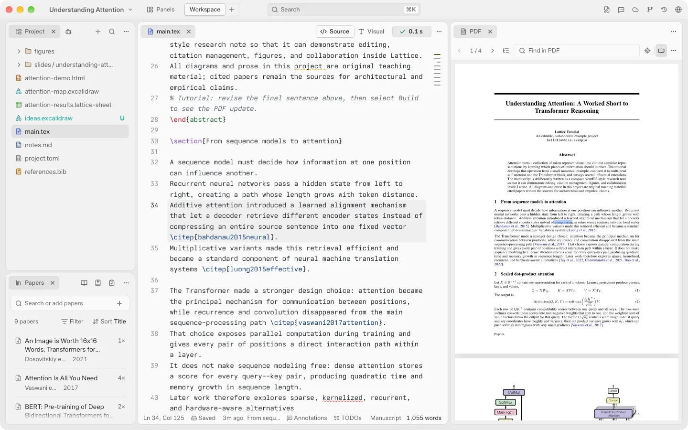

# Writing

## The editor

A `.tex` file opens in the source editor, with completion and diagnostics as you type. Above it, switch between:

- **Source**: the LaTeX as written.
- **Visual**: the same file with headings, emphasis, equations, lists and figures drawn in place. You still edit the same text; switch back any time.

Useful while writing:

- **Format keys**: `⌘B` bold, `⌘I` emphasis, `⌘⇧M` inline math, `⌘/` comment a line, `⌘⌥E` wrap in an equation. The full list is in **Keyboard shortcuts** (`⌘?`).
- **Find and replace**: `⌘F` in the file, `⌘⇧F` in the whole project.
- **Go to**: `⌘P` opens any file, `⌘G` a line, `⌘⇧O` a section or label.
- **Outline**: the status bar's section name, or the marks at the right edge of the editor, take you through the document's structure.
- Markdown notes, spreadsheets, HTML pages, slides and [boards](boards.md) live in the same project and open in their own editors.

Lattice saves as you type. **Saved** in the status bar shows when.

## The PDF beside your source

Every save builds the PDF (see [Building](building.md)) and the PDF panel updates in place. To move between them:

- In the PDF, **double-click** a sentence to jump to the source line that wrote it.
- In the source, press `⌘⇧J` (**Jump to PDF**) to show the current line in the PDF.

The PDF can also move to a window of its own for a second screen: **Open the PDF in a separate window** in the command palette (`⌘K`).
