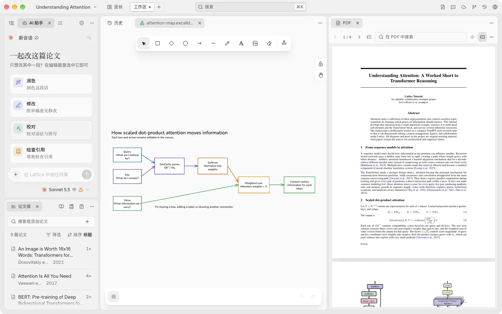

# AI 助手

AI 助手面板运行一个编程智能体：它能读你的项目和论文、修复编译错误、修改文件。它做的每处修改都以差异显示，可以审阅或撤回，并记入 [历史](history.md)。Lattice 本身不附带模型或 AI 订阅，需要你自己提供。

## 接入助手

打开 **AI 助手** 面板（`⌘⌥3`，或左侧的机器人图标），然后选择一种方式：

- Mac 上以你的身份登录的 **Claude Code** 或 **Codex**。安装命令行工具，在「终端」里登录一次（例如 `claude auth login`），再在输入框下方的模型菜单中选中它。
- 你安装的 **其他智能体命令行工具**，例如 Cursor、OpenCode 或 Droid。
- **你自己的 API**：**设置 › AI 助手 › 模型接口** 填入兼容 OpenAI 或 Anthropic 的地址、密钥（保存在钥匙串中）和模型名，无需安装其他东西。

**设置 › AI 助手 › 模型** 设置默认的服务商，以及 Lattice 自己做小任务（校对、提交说明、修复编译）时用的模型。**MCP** 可以给助手添加 Zotero 等工具；**用量与限制** 显示用了多少。

## 使用

- 在输入框写下你的要求，按回车。提到某个文件，它就会去看那个文件。
- **润色**、**修改**、**校对** 和 **检查引用** 用来启动常见任务。只想改其中一段时，先在编辑器里选中它。
- 在编辑器里选中文字后，可以直接 **校对**（`⌘⌥P`）、**润色** 或 **改写**，每处修改都附带理由。
- **批注** 一段文字（选中，选择 **批注**，写下要怎么改），再点 **保存并立即修改**：助手为每条批注提出修改，你在原处接受或拒绝。命令面板里的 **根据批注修改** 会分轮处理所有未完成的批注。
- 编译失败时，问题上的 **交给助手** 会把它直接发到这里。

会话按项目保存；会话名旁边的时钟图标列出之前的会话。会话上的 **×** 是归档而不是删除：**设置 › AI 助手 › 已归档的对话** 列出已归档的会话（包括闲置一段时间后自动归档的），可以把会话恢复到历史记录，也可以永久删除。

在原生 Lattice 中，你在经典版本里的会话也会出现。每次原生版本的助手启动时，都会补上经典版本里它还没有的会话，并用一条简短的提示告诉你带来了多少个。继续这样的会话时，会接着之前的消息。

## 单独的窗口

在原生 Lattice 中，点助手面板标题栏上的 **在单独窗口中打开**，助手会移到它自己的窗口里，会话、草稿和正在进行的回复都原样保留。点 **放回工作区**、在命令面板中运行同名命令，或关掉这个窗口，它就回到原处。窗口的位置和大小按项目记住，并随项目一起重新打开。
