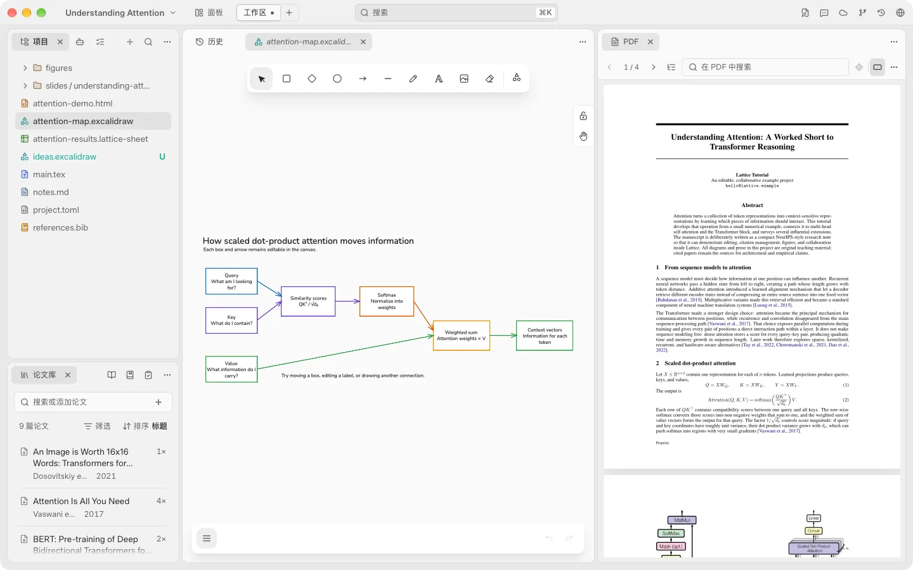

# 白板

白板是保存在项目里的 [Excalidraw](https://excalidraw.com) 画布，文件扩展名为 `.excalidraw`。可以用来构思还没定稿的图、画给合作者看的示意图，或者在论文旁边记笔记。

## 新建白板

在 **项目** 面板的空白处（或某个文件夹上）右键，选择 **新建文件**，文件名以 `.excalidraw` 结尾，例如 `ideas.excalidraw`，就会打开一块空白板。其他地方的 `.excalidraw` 文件也一样能打开：用同一菜单里的 **导入文件…**。

## 绘图

顶部工具栏有选择、矩形、菱形、椭圆、箭头、直线、自由画笔、文字、图片和橡皮擦。箭头会吸附到图形上，移动图形时保持连接。锁定按钮让当前工具保持选中；手形工具用来平移画布。撤销和重做在右下角，左下角的菜单有导出和画布选项。

白板边画边保存，和其他文件一样出现在 [历史](history.md) 里，也会作为普通文件同步到 Overleaf。AI 助手也能读取和修改白板。
