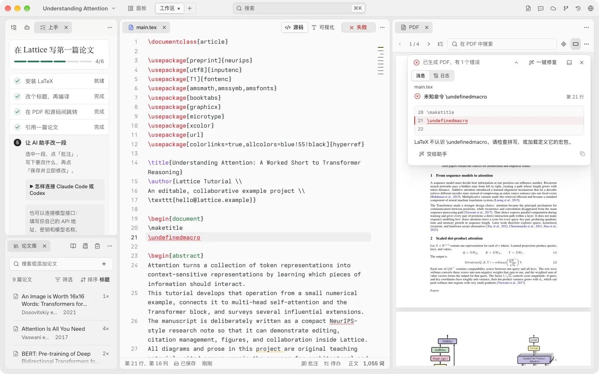

# 编译与排错

## 编译

按 `⌘S` 保存并编译。默认情况下，停止输入后 Lattice 也会自动编译（**设置 › 编辑编译 › 自动编译**）。编辑器上方的编译按钮显示结果和耗时，点击可以重新编译。

在命令面板（`⌘K`）中：

- **从头编译**：删除编译中间文件后重新编译。编译表现异常时可以试试。
- **清理缓存**：只删除中间文件。
- **停止编译**：停止正在进行的编译。

编译引擎（pdfLaTeX、XeLaTeX 或 LuaLaTeX）、shell escape 以及中间文件的位置在 **设置 › 编辑编译 › 编译** 中设置。项目里的 `latexmkrc` 会覆盖引擎设置。

## 查看并修复编译问题

编译失败时，编译按钮变红，PDF 上方弹出问题面板。每个问题标明文件和行号，显示附近的源码，并用通俗的话说明 LaTeX 报了什么错。

- 点击问题跳到对应行；用 `F8` 和 `⇧F8` 可以在问题之间切换。
- **日志** 显示 LaTeX 原始日志。
- **交给助手** 把这个问题交给 AI 助手；**一键修复** 让它修复所有问题。
- 缺少的宏包可以直接在问题里安装。

## 导出

- **导出 arXiv 提交包…**（项目菜单或 **文件** 菜单）生成一个可以独立编译的 ZIP。
- **导出 ZIP…** 导出整个项目，Overleaf 可以直接导入。
- PDF 面板的菜单可以保存编译好的 PDF。
