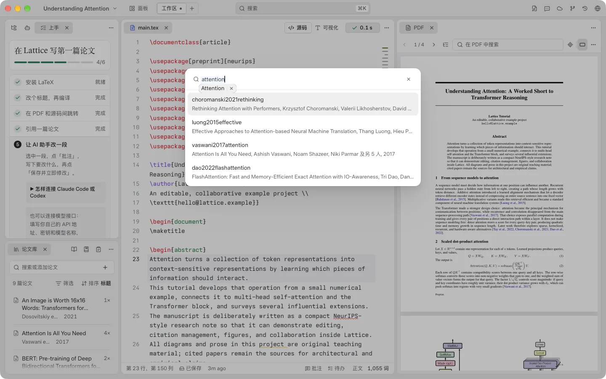
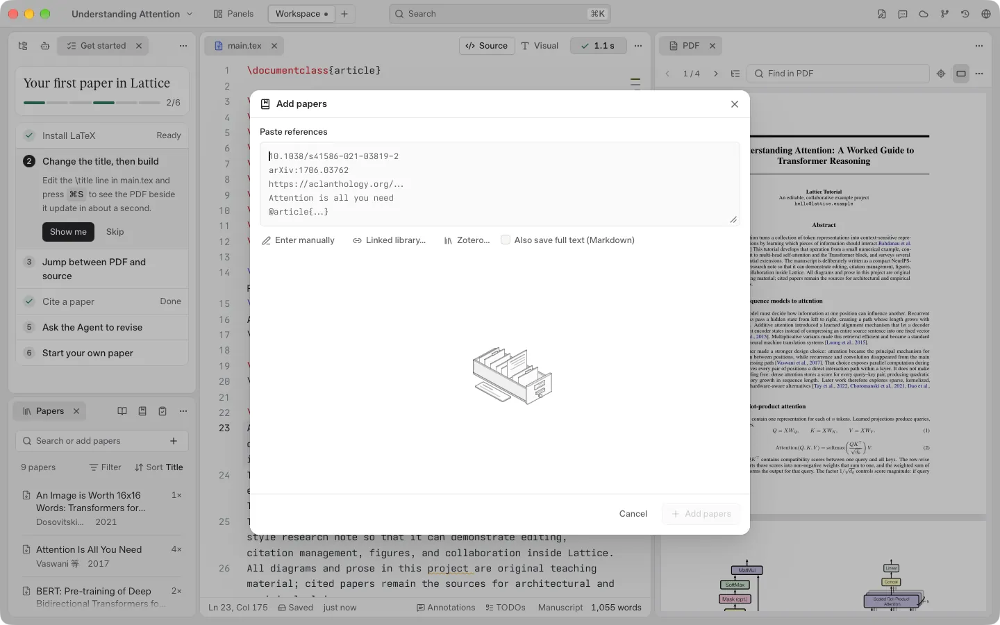

# 引用与论文库

## 边写边引用

- `⌘⇧K` **插入引用**：按 key、标题或作者搜索参考文献，回车后在光标处插入 `\cite{key}`。
- `⌘⇧L` **引用编号**：搜索项目中的 label（`eq:`、`fig:`、`tab:` 等），插入 `\ref{…}`。
- 鼠标悬停在 `\cite` 的 key 上，可以看到它指向的文献。

## 论文库

**论文库** 面板（`⌘⌥2`）列出这个项目引用的论文，以及每篇被引用的次数。可以在草稿旁边打开阅读、筛选和排序，或者拖进编辑器来引用。

添加论文：点论文库搜索框旁的 **+**，粘贴手头的任何信息：DOI、arXiv ID、链接、标题或整段 BibTeX，每行一条，再点 **添加论文**。Lattice 会逐条查找并写进你的 `.bib` 文件。

同一个面板里的其他方式：

- **手动填写**：自己填写各个字段。
- **关联的文献库…**：关联从 Zotero、Paperpile 等工具导出的 `.bib`，之后它的改动经你确认后同步进来。
- **同时保存全文（Markdown）**：在项目里保存每篇论文的可读副本。

**检查引用**（论文库面板和命令面板中都有）会对照 Crossref 检查参考文献，逐条列出可疑之处。

## Zotero

无需在 Zotero 里做任何设置，Zotero 开着或关着都可以。

1. 在 **添加论文** 中选择 **从 Zotero 导入…**。
2. 打开 **我的文库** 或某个分类；打开 **包含子分类** 可以看到下面的全部论文。
3. 勾选需要的论文，或者 **全选**，再点 **添加 N 篇论文**。已经在库里的论文显示 **已在论文库**。

你在 Zotero 里对论文 PDF 做的批注会一起带进它的笔记（`notes/<key>.md`），每条都链接到对应页。Lattice 只读取 Zotero，从不写回。如果 Lattice 找不到你的文库，用 **选择 Zotero 文件夹…** 指定位置。更多内容（包括把 Zotero 接入 AI 助手）见 [Zotero, Heptabase and the Agent panel](https://github.com/lattice-writer/lattice/blob/main/docs/zotero-and-notes.md)（英文）。
