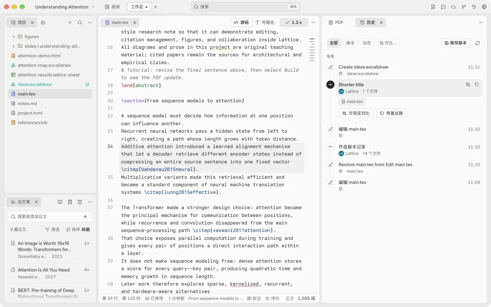
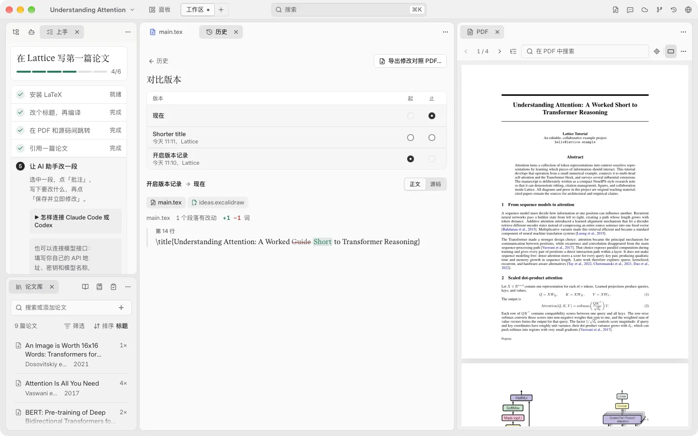

# 历史与版本对比

Lattice 记录项目里的每一处改动，不管是你、AI 助手，还是 Overleaf 上的合作者改的。点标题栏的 **历史** 按钮（时钟图标）或 **面板 › 历史** 打开。

## 撤回改动

**全部** 按时间倒序列出改动。点一条查看差异，再点 **恢复文件**，把文件恢复到这次改动之前的样子。恢复本身也是一条新记录，同样可以撤回。

**动态** 按事件（例如编译和助手的每轮操作）分组显示同一条时间线。

## 保存版本

命名版本基于 Git。第一次使用时，**版本** 页会提示 **记录版本**，把项目变成一个 Git 仓库（已经是仓库的项目直接使用）。之后：

- **保存版本**：用你起的名字记录项目当前的状态。
- 每个版本都可以恢复，或者和现在对比。

## 版本对比

在 **版本** 中选择 **对比…**，然后在 **起** 和 **止** 中选两个版本（**现在** 指磁盘上的当前项目）。Lattice 列出所有改动过的文件。**正文** 显示改动的词，读文字更方便；**源码** 显示逐行差异。

**导出修改对照 PDF…** 通过 TeX 发行版中的 `latexdiff` 生成一份标出差异的 PDF。使用 BasicTeX 时，可能需要先运行 `sudo tlmgr install latexdiff`。

## 跟踪修订

**跟踪修订** 打开审阅模式：从此之后你的修改都会在源码中标出来，可以逐条或一次性接受、拒绝。不需要 Overleaf 也能用。
