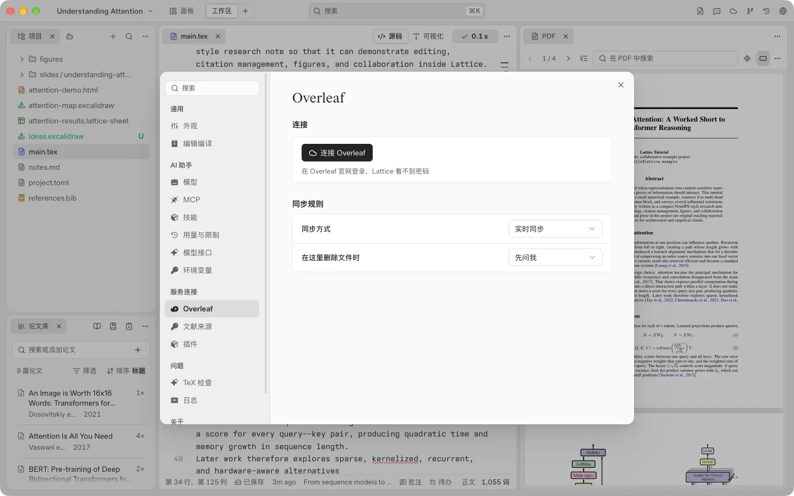

# Overleaf 同步

Lattice 与 Overleaf 双向同步。合作者照常在 Overleaf 上写，不需要安装 Lattice；他们的修改、评论、聊天和修订会实时出现在 Lattice 里。

## 连接

打开 **设置 › Overleaf**，点 **连接 Overleaf**。登录在 Overleaf 自己的页面上完成，Lattice 不会接触你的密码。

## 打开 Overleaf 项目

1. 在项目菜单或 **文件** 菜单中选择 **从 Overleaf 打开**，或者点标题栏的云朵按钮。
2. 搜索你的项目，或者粘贴项目链接。别人邀请你的项目也会列出来；请先在 Overleaf 上接受邀请。
3. 在 **下载到** 中选择本地副本的位置，然后打开项目。

Lattice 把项目下载到一个普通文件夹，并保持关联。如果本地已有副本，用 **关联此文件夹** 直接关联，不必重新下载。

## 把本地项目放到 Overleaf

打开项目后，打开同一个 Overleaf 面板，选择 **上传到 Overleaf**，填好名称，再点 **上传关联**。

## 同步规则

在 **设置 › Overleaf** 中设置：

- **同步方式**：**实时同步** 在输入时就收发修改；**手动** 只在你点 **立即同步** 时同步。
- **在这里删除文件时**：**先问我**（默认）、**Overleaf 上也删** 或 **Overleaf 上保留**。

两次同步之间两边都改了同一个文件时，Lattice 以上次同步的版本为基准合并两边：正文（.tex、Markdown、纯文本）按句子合并，其他文本文件按行合并。改的是不同句子时，即使在同一段里，两边的修改也都会保留。只有两人都改写过的地方才会被标出，直接标在文件里，你的文字和 Overleaf 的文字以不同底色并排显示，上面有 **保留我的**、**保留对方的** 和 **保留两者**；同步后会打开第一个有标记的文件并定位到那里。合并前的文字保存在 `.research/overleaf-conflicts/` 下，这个文件夹不会同步。

图片等二进制文件两边都改过时，保留较新的那份，另一份另存起来。提示会说明留下的是谁的版本，可以用 **用我的** 或 **用 Overleaf 的** 换回来。

项目里每个主文档编译出的 PDF 都不会同步。源码中作为图片引用的 PDF 照常同步。

Overleaf 不接受某些文件名，例如含反斜杠或星号，或以空格开头或结尾的文件名。这样的文件留在本机，其他文件照常同步，并有一条提示说明是哪个文件、违反了哪条规则。重命名后即可同步。把含有这类文件名的项目上传到 Overleaf 时，会先请你重命名。

Overleaf 上的评论和修订建议显示在源码边栏，以及 Overleaf 面板的评论、修订和聊天中。**视图 › 页边审阅** 设置边栏显示多少内容。
