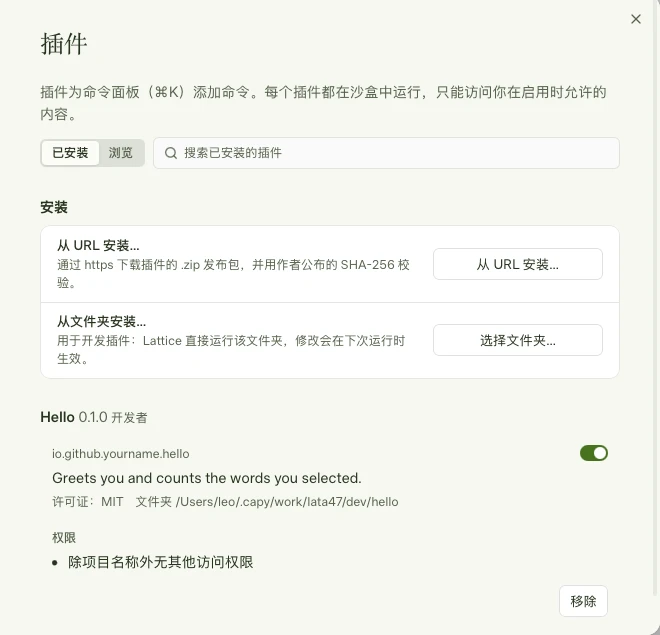
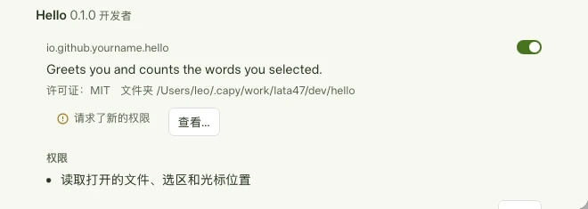
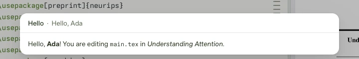

# 第一个插件

插件会往命令面板（`⌘K`）里添加命令。一个插件就是一个文件夹，里面有清单文件 `lattice-plugin.toml` 和一个 Node 脚本。运行它的某个命令时，Lattice 在沙盒中启动这个脚本，通过 stdin 把命令发给它，再把它的回答显示出来：一条消息、一个可供选择的列表，或者文件里的问题。插件从不自己绘制界面，也不自己写文件；它请 Lattice 去做，由用户确认。

本页一步步做出一个叫 Hello 的插件。[插件清单与 API](plugin-reference.md) 是它用到的所有内容的参考，[发布插件](plugin-publishing.md) 讲怎样把它上架到插件市场。

你需要：

- 一台装有 Lattice 0.18 或更高版本的 Mac。插件目前只在 macOS 上运行，Lattice 用自带的 Node 运行插件，所以安装你插件的人不需要再装任何东西；
- 终端里有 Node 22 或更高版本（`node --version`），用来在 Lattice 之外试运行插件和打包。

## 1. 新建文件夹

```sh
mkdir hello && cd hello
curl -fsSLO https://raw.githubusercontent.com/leo1oel/lattice/main/plugin-sdk/lattice-plugin.mjs
```

`lattice-plugin.mjs` 就是 SDK：一个 MIT 许可、没有依赖的文件，替你处理通信协议。它要放在你的文件夹里，因为插件只能读取自己的文件夹。它的 TypeScript 类型在 [plugin-sdk](https://github.com/leo1oel/lattice/tree/main/plugin-sdk) 里（`index.d.ts` 和 `api.d.ts`）。

## 2. 编写清单文件

新建 `lattice-plugin.toml`：

```toml
schema = 1
id = "io.github.yourname.hello"
name = "Hello"
version = "0.1.0"
api = 1
license = "MIT"
description = "Greets you and counts the words you selected."
runtime = "node"
main = "main.mjs"

[[commands]]
id = "greet"
title = "Say hello"
description = "Greets you by name."
input = { kind = "text", placeholder = "Your name" }
```

- `id` 是插件永久的身份：反向域名、全小写，用你自己拥有的名字，例如 `io.github.<你的 GitHub 用户名>.<插件名>`。`app.lattice.*` 留给 Lattice 自己的插件。
- `api = 1` 是插件需要的最低插件 API 级别。Lattice 0.18 支持级别 1。
- 每个 `[[commands]]` 在命令面板里显示为“Hello: <title>”。`input = { kind = "text" }` 表示运行命令前先让用户输入一段文字。

## 3. 编写命令

新建 `main.mjs`：

```js
import { definePlugin, PluginError } from "./lattice-plugin.mjs";

definePlugin({
  commands: {
    async greet({ input, context }) {
      const name = input?.trim();
      if (!name) throw new PluginError("Type your name first.");
      return {
        kind: "message",
        summary: `Hello, ${name}`,
        markdown: `Hello, **${name}**! This is *${context.project.name}*.`,
      };
    },
  },
});
```

`commands` 下的每个键是清单里的一个命令 id。处理函数会收到 `{ input, context, host, signal }`，返回一个结果。抛出 `PluginError` 则把它的消息显示给用户。

## 4. 在终端里试运行

Lattice 和插件之间用 JSON-RPC 通信，每行一条 JSON 消息。你可以自己扮演 Lattice：

```sh
(
  echo '{"jsonrpc":"2.0","id":1,"method":"initialize","params":{"hostApiLevel":1,"hostApiCompat":1}}'
  echo '{"jsonrpc":"2.0","id":2,"method":"command/run","params":{"command":"greet","input":"Ada","context":{"project":{"name":"thesis"}}}}'
  sleep 1
) | node main.mjs
```

插件回答这两条消息：

```text
{"jsonrpc":"2.0","id":1,"result":{"apiLevel":1}}
{"jsonrpc":"2.0","id":2,"result":{"kind":"message","summary":"Hello, Ada","markdown":"Hello, **Ada**! This is *thesis*."}}
```

如果把 `"input"` 改成 `""`，它会改为回答 `{"code":-32000,"message":"Type your name first."}`。`sleep 1` 让 stdin 在插件回答期间保持打开：stdin 一关闭 SDK 就退出，因为 Lattice 正是这样结束一次运行的。

## 5. 从文件夹安装

1. 打开 **设置 › 插件**，在 **从文件夹安装…** 旁边选择 **选择文件夹…**，选中 `hello` 文件夹。
2. Hello 出现在 **已安装** 中，标为 **开发者**，处于关闭状态。把它开启：Lattice 会问“启用 Hello？”，并列出它将能够做的事，这里是“除项目名称外无其他访问权限”。选择 **启用**。
3. 打开一个项目，按 `⌘K`，输入“hello”，选择 **Hello: Say hello**。输入你的名字，按回车。命令面板显示“Hello, **Ada**! This is *Understanding Attention*.”



Lattice 直接运行这个文件夹，并且每次运行都会重新读取，所以保存 `main.mjs` 或清单文件后，再运行一次命令即可。

## 6. 读取项目

没有任何权限时，插件只能知道项目的名称。要读取更多内容，插件要在清单里申请，用户开启它时同意。把 `lattice-plugin.toml` 换成下面这一版，它加上了 `[permissions]` 表和第二个命令：

```toml
schema = 1
id = "io.github.yourname.hello"
name = "Hello"
version = "0.1.0"
api = 1
license = "MIT"
description = "Greets you and counts the words you selected."
runtime = "node"
main = "main.mjs"

[permissions]
project-read = ["context"]

[[commands]]
id = "greet"
title = "Say hello"
description = "Greets you by name."
input = { kind = "text", placeholder = "Your name" }

[[commands]]
id = "count"
title = "Count words in the selection"
```

`project-read = ["context"]` 让插件拿到主文档、当前文件、参考文献路径、选区（最多 12,000 个字符）和光标位置。再把 `main.mjs` 换成下面这一版，用上它们：

```js
import { definePlugin, PluginError } from "./lattice-plugin.mjs";

definePlugin({
  commands: {
    async greet({ input, context, host }) {
      const name = input?.trim();
      if (!name) throw new PluginError("Type your name first.");
      host.log("info", `greeting ${name}`);
      const file = context.project.activeFile ?? "no file";
      return {
        kind: "message",
        summary: `Hello, ${name}`,
        markdown: `Hello, **${name}**! You are editing \`${file}\` in *${context.project.name}*.`,
      };
    },

    async count({ context }) {
      const selection = context.selection;
      if (!selection?.text) throw new PluginError("Select some text first.");
      const words = selection.text.split(/\s+/).filter(Boolean).length;
      return {
        kind: "items",
        summary: `${words} words selected`,
        items: [
          {
            id: "words",
            title: `${words} words`,
            subtitle: `${selection.file}, line ${selection.from.line}`,
            actions: [
              { type: "copy", title: "Copy the count", text: String(words) },
              { type: "reveal", title: "Show the selection", file: selection.file, line: selection.from.line },
            ],
          },
        ],
      };
    },
  },
});
```

`count` 返回的是一个列表而不是消息。每个条目带有操作（action），即 Lattice 替插件执行的动作：按回车执行第一个，这里是复制字数。

带上选区试运行 `count`：

```sh
(
  echo '{"jsonrpc":"2.0","id":1,"method":"initialize","params":{"hostApiLevel":1,"hostApiCompat":1}}'
  echo '{"jsonrpc":"2.0","id":2,"method":"command/run","params":{"command":"count","context":{"project":{"name":"thesis"},"selection":{"file":"main.tex","text":"Attention is all you need","from":{"line":12,"column":1},"to":{"line":12,"column":26}}}}}'
  sleep 1
) | node main.mjs
```

回到 Lattice，再运行一次 **Hello: Say hello**。它不会运行：插件现在申请的权限超出了你允许的范围，所以命令面板提示“此插件请求了新的权限。请在“设置 › 插件”中查看。”选择 **打开设置**。Hello 的卡片显示 **请求了新的权限**；选择 **查看…**，核对列表，再选择 **启用**。所有已安装的插件都是这样，所以插件不可能在用户不知情的情况下获得访问权限。



现在 **Hello: Say hello** 会说出你正在编辑的文件，**Hello: Count words in the selection** 会统计你选中的字数；按回车复制这个数字。



## 7. 查看日志

- **`host.log(level, message)`** 写入 Lattice 的日志 `~/Library/Logs/app.leo1oel.researchwriter/lattice.log`，每行带有 `lattice::plugins` 标记和你插件的 id。开发时可以一直跟着看：

  ```sh
  tail -f ~/Library/Logs/app.leo1oel.researchwriter/lattice.log | grep --line-buffered lattice::plugins
  ```

  运行 **Hello: Say hello** 会添加一行，结尾是 `io.github.yourname.hello: greeting Ada`。**设置 › 日志 › 打开日志文件夹** 可以打开这个文件夹。
- **`console.log` 和 stderr。** SDK 把 `console.log` 输出到 stderr，因为 stdout 用来传协议。插件没有作答就停止时，Lattice 会在命令面板里显示它 stderr 的最后部分。其他情况下 stderr 只在 `debug` 级别写入日志，所以要从终端启动 Lattice 才能看到：

  ```sh
  LATTICE_LOG=debug /Applications/Lattice.app/Contents/MacOS/research-writer
  ```

- **不要自己往 stdout 打印。** stdout 上出现一行不是 JSON-RPC 的内容，这次运行就会结束，命令面板显示“插件返回了 Lattice 无法读取的内容”。

## 接下来

- [插件清单与 API](plugin-reference.md)：所有权限、Lattice 调用、结果和操作。
- [发布插件](plugin-publishing.md)：打包 Hello，上架插件市场，发布更新。
- 两个可以照抄的真实插件：[bib-check](https://github.com/leo1oel/lattice/tree/main/examples/plugins/bib-check)（检查 `.bib` 文件的问题）和 [zotero-search](https://github.com/leo1oel/lattice/tree/main/examples/plugins/zotero-search)（搜索 Zotero 并插入引用）。
