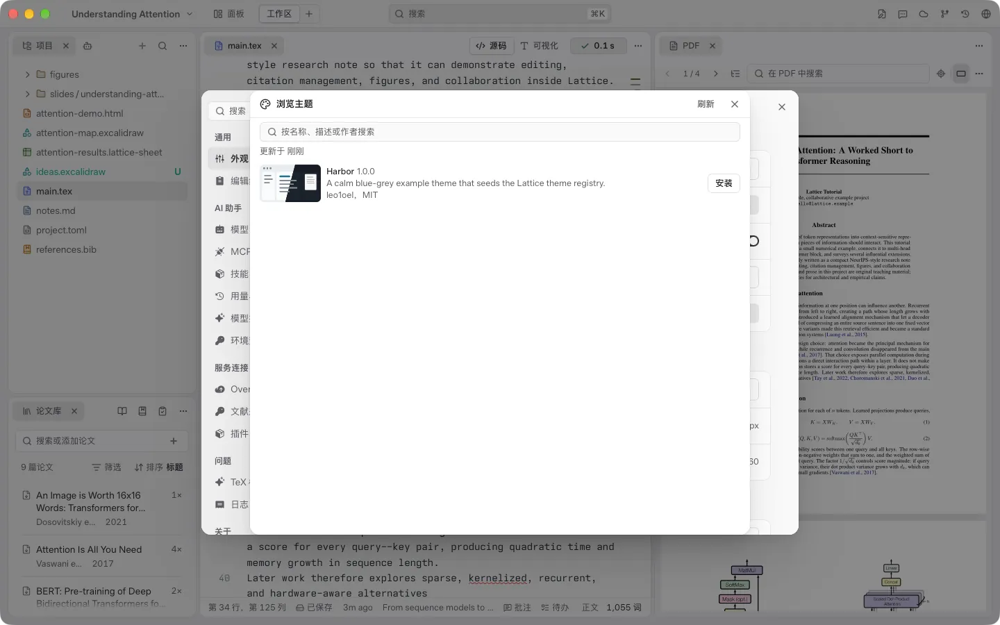
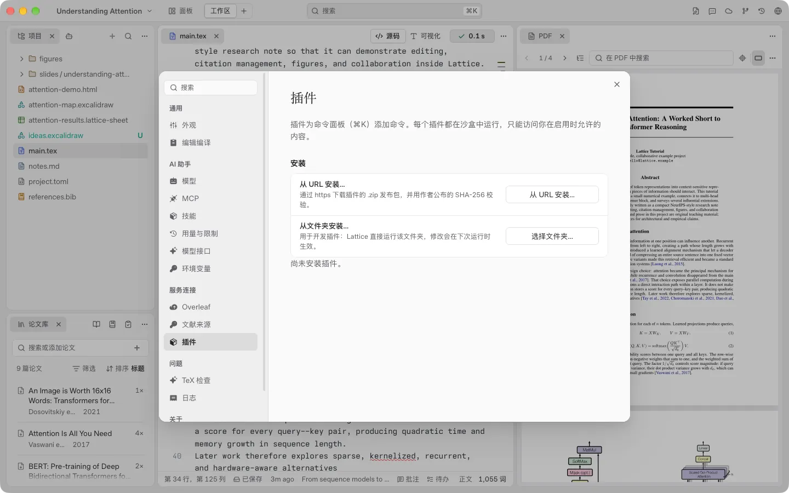

# 插件与主题

## 主题

打开 **设置 › 外观**。在 **主题** 下可以选择内置的浅色或深色主题，或者：

- **浏览主题…**：别人发布的主题。点某个主题的 **安装**，再从你的主题中选中它。
- **从文件安装…**：别人发给你的主题文件。
- **显示主题文件夹**：已安装的主题文件所在的位置。

编辑器的语法配色在同一页的 **代码主题** 中单独设置。

## 插件

插件会往命令面板（`⌘K`）里添加命令。每个插件都在沙盒中运行，只能访问你开启时允许的内容。

打开 **设置 › 插件**。这一页有 **已安装** 和 **浏览** 两个视图，共用一个搜索框，搜索当前显示的视图。

### 浏览插件市场

**浏览** 列出 Lattice 插件市场中的插件。列表带有签名，被篡改的列表会被拒绝；离线时显示最后一次校验通过的列表。可以按下载最多、最近更新或名称排序，点 **刷新** 重新获取列表。

点某个插件查看详情：作者、版本和许可证、**此插件可以** 做什么和不能做什么，以及它添加的命令。然后选择：

- **安装并启用**：安装插件并开启。
- **仅安装**：安装但保持关闭，之后再开启。

### 已安装的插件

每个已安装的插件都标明来源：来自插件市场的是 **已审核**，从 URL 安装的是 **未经审核**，从文件夹安装的是 **开发者**。用开关开启或关闭插件；开启时会列出它申请的权限。在插件卡片上可以移除插件。

有更新时，卡片上会提示。**全部更新** 会应用所有不需要新权限的更新。需要比你已允许的更多权限的更新会单独留在卡片上，只列出新增的部分，可以选择 **允许并更新**，或保留当前版本。

如果某个插件被从市场撤下，Lattice 会将其关闭，并在卡片上说明原因（**了解更多**）。插件目前只能在 macOS 上运行。

### 自己安装插件

- **从 URL 安装…**：通过 `https` 下载插件的 `.zip` 发布包，并核对作者公布的 SHA-256。
- **从文件夹安装…**：用于开发插件；Lattice 直接运行这个文件夹，你的修改在下次运行时生效。

想写插件或主题？从 [第一个插件](plugin-development.md) 或 [制作主题](theme-development.md) 开始。
