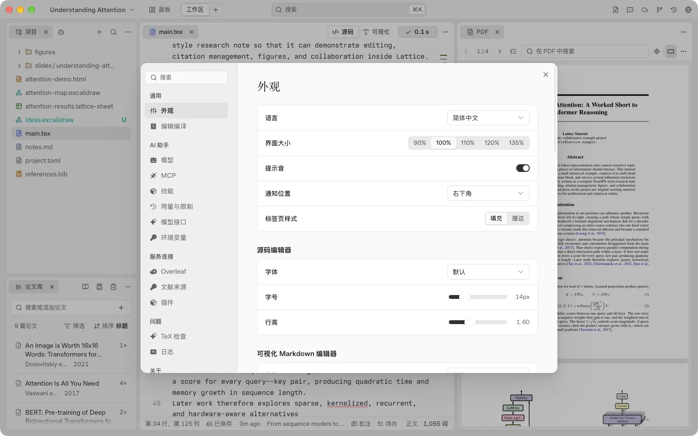
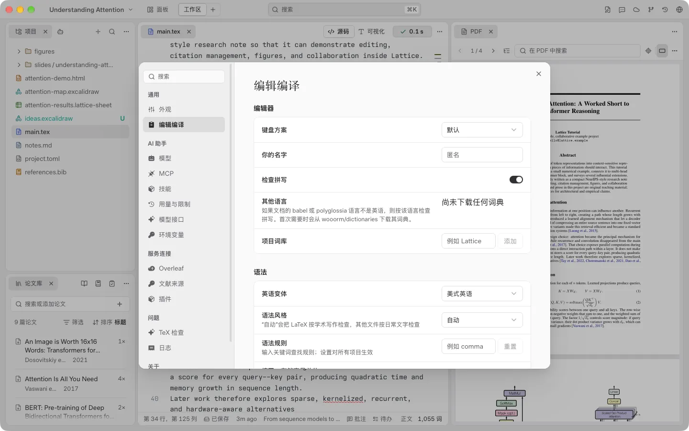
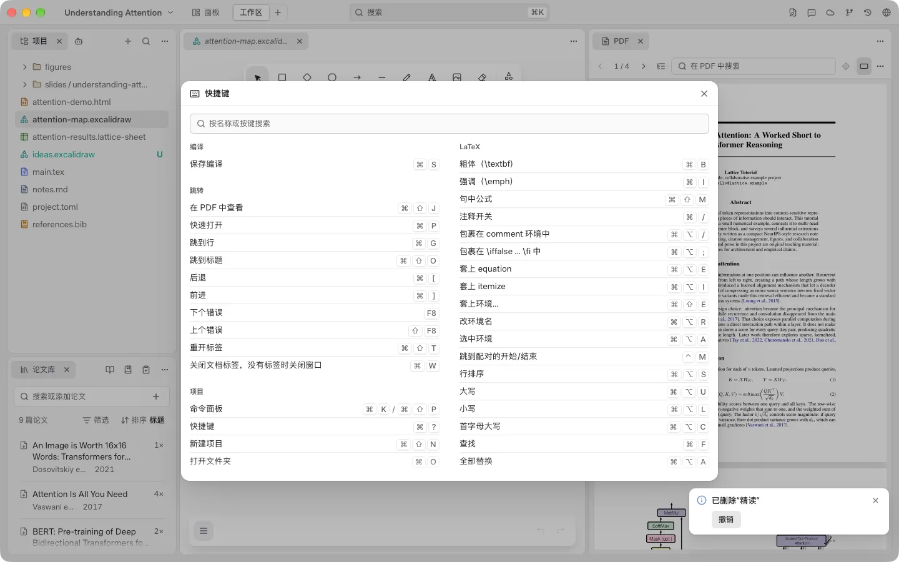

# 设置与快捷键

## 设置

打开 **Lattice › 设置…**（`⌘,`）。顶部的搜索框可以按名称找到任何设置。

| 分组 | 内容 |
| --- | --- |
| **外观** | 界面语言（English 或简体中文）、界面大小、声音、通知位置、标签样式、编辑器字体、主题和代码主题、标题栏工具。 |
| **编辑编译** | 键盘方案（默认、Vim 或 Emacs）、你的名字、拼写和语法检查（Apple 芯片 Mac 上只检查拼写，使用 macOS 的检查器）、自动编译、中间文件、编译引擎、shell escape、更新。 |
| **AI 助手** | 模型、MCP、技能、用量与限制、已归档的对话、模型接口、环境。见 [AI 助手](agent.md)。 |
| **服务连接** | Overleaf、文献来源（文献检索用的密钥）、插件。 |
| **问题** | TeX 检查、日志。 |

`⌘+`、`⌘−` 和 `⌘0`（或 **视图 › 放大 / 缩小 / 实际大小**）临时调整界面大小。

## 快捷键

按 `⌘?`（`⌘⇧/`）打开 **快捷键**，查看完整列表，可以按名称或按键筛选。列表跟随当前可用的命令，因此总是最新的。值得先记住的几个：

| 按键 | 作用 |
| --- | --- |
| `⌘K` | 命令面板：按名称找到任何命令 |
| `⌘S` | 保存并编译 |
| `⌘P` | 快速打开文件 |
| `⌘⇧K` / `⌘⇧L` | 插入引用 / 引用编号 |
| `⌘⇧J` | 在 PDF 中查看 |
| `F8` / `⇧F8` | 下一个 / 上一个编译问题 |
| `⌘⇧F` | 在项目中查找 |
| `⌘⌥1`、`⌘⌥2`、`⌘⌥3` | 项目、论文库、AI 助手面板 |
| `⌘1` … `⌘9` | 切换工作区 |
| `⌘⇧D` | 专注 |
| `⌘W` / `⌘⇧T` | 关闭标签 / 重新打开 |

想在编辑器里用 Vim 或 Emacs 按键，在 **设置 › 编辑编译 › 键盘方案** 中设置。
