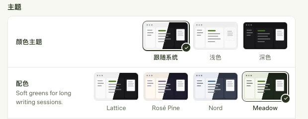

# 制作主题

主题给 Lattice 换配色。它是数据，不是代码：一个 `.lattice-theme.json` 文件，为 Lattice 的设计角色（例如窗口、编辑器、文字和强调色）指定颜色。其他颜色（悬停、按下、选中时的底色）都由 Lattice 根据这些颜色推算，所以主题在各种状态下都保持一致。主题改不了尺寸、字体或行为，也不能运行任何东西，所以安装主题不需要任何权限，并且所有平台都能用。

## 1. 编写主题文件

新建 `meadow.lattice-theme.json`：

```json
{
  "$schema": "https://lattice-writer.github.io/lattice-plugins/schema/theme-1.json",
  "schema": 1,
  "id": "io.github.yourname.meadow",
  "name": "Meadow",
  "version": "1.0.0",
  "author": "Your Name",
  "license": "MIT",
  "description": "Soft greens for long writing sessions.",
  "variants": [
    {
      "id": "day",
      "name": "Meadow Day",
      "appearance": "light",
      "colors": {
        "window": "#eef2e6",
        "chrome": "#e4eadb",
        "panel": "#f6f8f1",
        "editor": "#fbfcf8",
        "text": "#27331f",
        "text-secondary": "#56624c",
        "line": "#27331f1f",
        "accent": "#4f7a28"
      },
      "syntax": { "keyword": "#4f7a28", "comment": "#6f7a66" }
    },
    {
      "id": "night",
      "name": "Meadow Night",
      "appearance": "dark",
      "colors": {
        "window": "#161b13",
        "chrome": "#1c2318",
        "panel": "#20281b",
        "editor": "#1a2016",
        "text": "#e3ead8",
        "text-secondary": "#a9b49c",
        "line": "#e3ead81f",
        "accent": "#9cc56b"
      }
    }
  ]
}
```

`$schema` 这一行让 VS Code 等编辑器在你输入时检查文件、补全角色名。

- **`id`** 是反向域名、全小写，属于你自己，和插件一样。`app.lattice.*` 属于 Lattice 自带的主题。
- **变体：** 1 到 8 个，每个是 `light` 或 `dark`。Lattice 使用第一个与窗口外观相符的变体；只有深色变体时，浅色外观保持 Lattice 自己的配色。
- **颜色只能是字面值 `#RRGGBB` 或 `#RRGGBBAA`。** 不能用颜色名、`var()` 或其他函数。线条通常是半透明的，如上例。
- **每个角色都是可选的。** 没写的角色沿用 Lattice 在该外观下的颜色，所以一个主题可以小到只有两个表面色和一个强调色。
- 未知的角色是错误。文件最大 256 KiB。

## 角色

| 部分 | 角色 |
|---|---|
| `colors`，表面 | `window`、`chrome`、`panel`、`raised`、`input`、`editor`、`pdf-ground` |
| `colors`，文字 | `text`、`text-secondary` |
| `colors`，线条 | `line`、`line-strong` |
| `colors`，强调 | `accent`、`focus`、`selection` |
| `colors`，状态 | `danger`、`success`、`warning`、`info`、`annotation` |
| `syntax` | 编辑器的 16 种语法颜色，例如 `keyword`、`command` 和 `comment` |
| `terminal` | `black` … `white` 和 `bright-black` … `bright-white` |

Lattice 会保证文字可读：文字、状态和语法颜色在其背景上达不到 4.5:1 对比度时，会在保持色相的前提下调整到够为止，强调色则保证 4.6:1。只有经过大幅校正才可读的主题看起来会不对劲，所以请自己检查配色。完整的角色列表见 [docs/themes.md](https://github.com/leo1oel/lattice/blob/main/docs/themes.md#roles)（英文）和 [JSON Schema](https://github.com/leo1oel/lattice/blob/main/design-system/themes/theme-1.schema.json)。

## 2. 在 Lattice 中试用

1. 打开 **设置 › 外观**。在 **主题** 下的 **主题文件** 旁边选择 **从文件安装…**，选中 `meadow.lattice-theme.json`。
2. Lattice 安装后会直接选中它：Meadow 出现在 **配色** 中并被勾选，旁边显示它的描述。把 **颜色主题** 在 **浅色** 和 **深色** 之间切换，查看两个变体。

Lattice 在安装时会检查文件，并指出哪里不对，例如未知的角色。它会保存一份副本，所以修改文件之后，要再安装一次才能看到变化。



## 3. 发布

主题和插件走同一个注册表，条目更简单。注册表的地址列在 [注册表地址](plugin-publishing.md#注册表地址)。

1. 把主题文件和许可证放进一个公开的 GitHub 仓库（这里是 `https://github.com/yourname/lattice-theme-meadow`），给提交打标签：

   ```sh
   git tag v1.0.0
   git push origin v1.0.0
   ```

2. 计算已提交文件的哈希。主题不需要打包，哈希就是文件本身的：

   ```sh
   shasum -a 256 meadow.lattice-theme.json
   ```

3. 在注册表的 fork 里添加 `themes/<id>/entry.json`，这里是 `themes/io.github.yourname.meadow/entry.json`：

   ```json
   {
     "id": "io.github.yourname.meadow",
     "version": "1.0.0",
     "repository": "https://github.com/yourname/lattice-theme-meadow",
     "tag": "v1.0.0",
     "commit": "<the full 40-character sha the tag points at>",
     "path": "meadow.lattice-theme.json",
     "sha256": "<what shasum printed>"
   }
   ```

   `id` 和 `version` 与主题文件一致，文件夹名等于 `id`，`path` 是该文件在仓库里的路径。

4. 和 [插件](plugin-publishing.md#3-添加条目) 一样，在 fork 里运行 `npm ci` 和 `node scripts/validate.mjs --base origin/main`。新主题会打印 `ok   themes/io.github.yourname.meadow/entry.json` 和 `note: new theme: needs a human review (first submission)`。
5. 开 pull request，填写检查清单中主题的部分。

CI 只拉取你的标签，要求它指向 `commit`，从该提交读取 `path` 处的文件（必须是普通文件，最大 256 KiB），核对它的 SHA-256，按 schema 校验，并检查它的 `id` 和 `version` 与条目一致、变体 id 不重复。

然后审核者会问：

1. id 或名称是否在冒充他人？
2. 描述是否准确，许可证是否齐全，仓库是否真实且公开？移植的配色要注明原作者并保留其许可证。
3. 是否可读？只有经过 Lattice 对比度校正才能用的主题会被拒绝。
4. 是否只是数据？不能有字体、图片或 schema 之外的内容。

合并后，主题会像插件一样随下一次索引签名发布（见 [签名](plugin-publishing.md#6-签名)），出现在 **设置 › 外观 › 浏览主题…** 中。那里的预览色块是根据索引绘制的，所以用户点 **安装** 之前不会下载任何东西。

## 更新与紧急停用

更新主题时，在文件里升高 `version`，给新提交打标签，再修改条目里的 `version`、`tag`、`commit` 和 `sha256`。版本只能升高。从 **浏览主题** 安装过的用户会收到更新提示，更新后仍保持他们选中的主题。

注册表的 [紧急停用开关](plugin-publishing.md#紧急停用开关) 同样适用于主题。用户选中的某个版本被 `"disable"` 停用时，Lattice 改用自己的配色，同时保留用户的选择，并在 **设置 › 外观** 中显示“<名称> 已被停用：<原因>”。`"warn"` 条目会让主题继续生效，并在那里显示警告。从文件安装的主题永远不会被停用。
