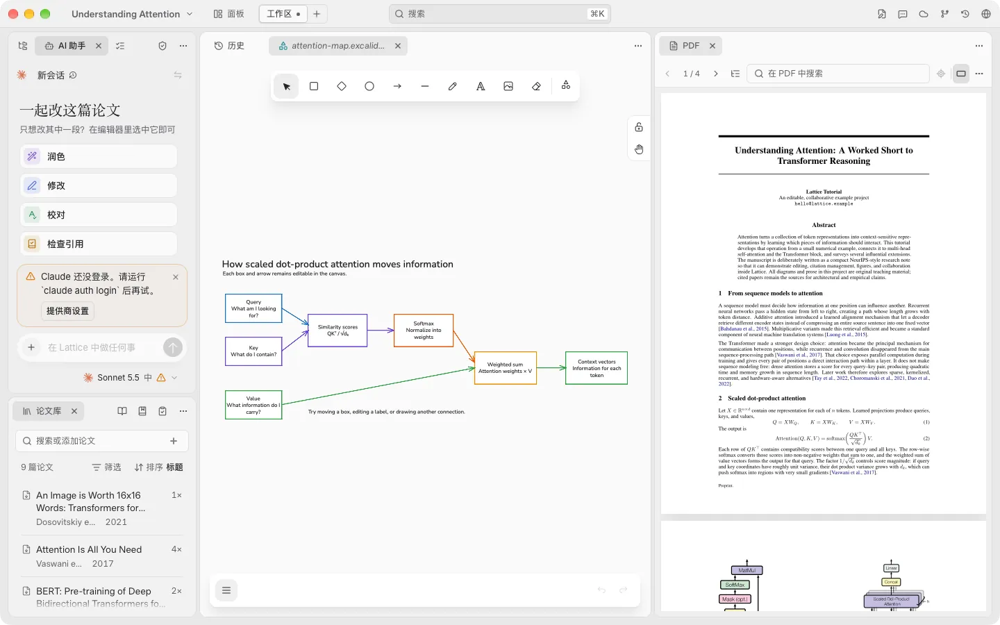

# 常见问题

**编译失败，看不出原因。** 先看编译问题面板里的第一个问题，后面的往往是它引起的。打开 **日志** 看 LaTeX 的原话。然后在命令面板（`⌘K`）里试试 **从头编译**。见 [编译与排错](building.md)。

**提示缺少 LaTeX 依赖，或找不到某个宏包。** BasicTeX 并不包含 Overleaf 上的全部宏包。点问题里的安装按钮，或者使用 **设置 › TeX 检查 › 安装所需工具**。

**编译完全找不到 LaTeX。** 打开 **设置 › TeX 检查**。如果列出缺少的工具，从「上手」清单或 [MacTeX](https://tug.org/mactex/) 安装 TeX，再重新打开项目。

**添加论文或查找引用不起作用。** 这些功能需要小工具 `uv`。**设置 › TeX 检查** 会显示 `uv` 和 `uvx` 是否存在；**安装所需工具** 会安装它们。

**AI 助手提示未登录。** 面板会显示哪个服务商没有登录，例如「Claude is not authenticated」。在「终端」里登录一次（Claude Code 用 `claude auth login`）再试，或者在 **模型设置** 中换一个服务商。

**Overleaf 不再同步。** 打开 **设置 › Overleaf**。如果登录过期，点 **重新连接**。含有冲突标记的文件会暂停同步，直到你解决冲突。

**某个面板不见了。** **面板 › 重置布局** 会找回所有面板。误删了工作区，马上点通知里的 **撤销**。

**文字丢了。** 打开 [历史](history.md)：每次保存、每次助手修改、每次 Overleaf 上的改动都在里面，**恢复文件** 可以把文件找回来。

**遇到其他问题。** **帮助 › 报告问题…** 会保存一份去除隐私信息的日志，你可以附到 issue 里，并打开 [GitHub Issues](https://github.com/lattice-writer/lattice/issues)。**设置 › 日志** 可以在应用内查看日志。
