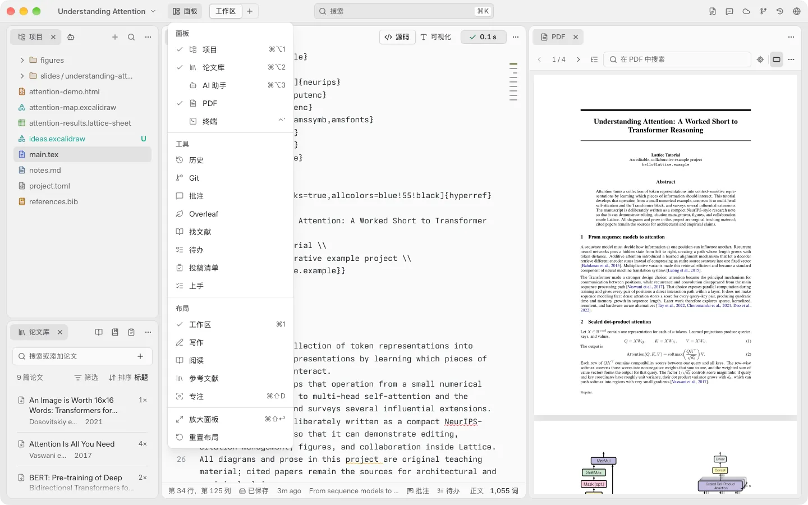
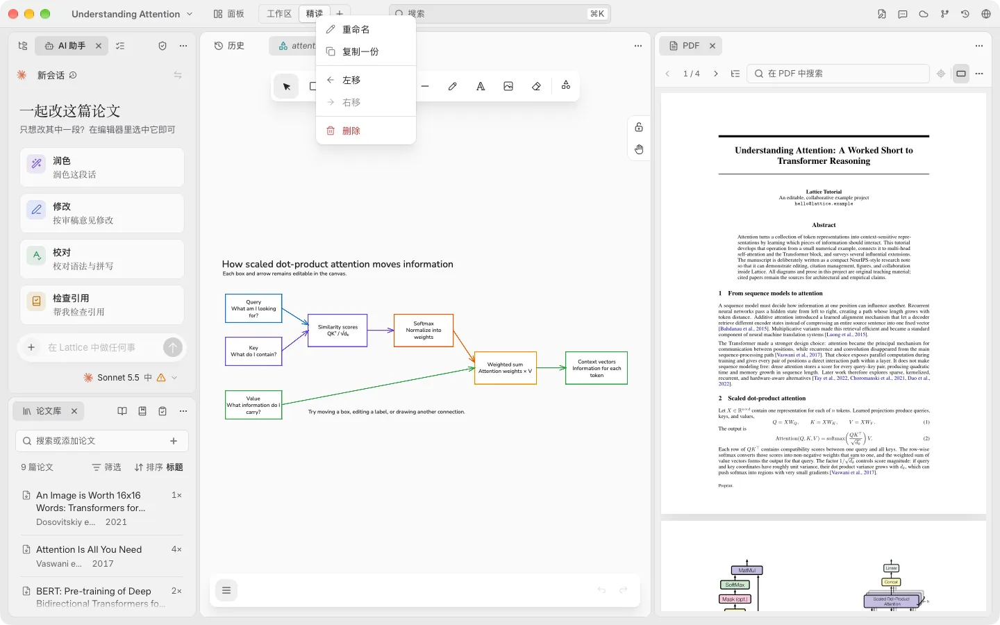

# 面板与工作区

## 面板

窗口里的一切都是面板：项目、论文库、AI 助手、PDF、终端，以及历史、批注、Overleaf、找文献、待办、投稿清单等工具。标题栏的 **面板** 菜单可以显示或隐藏每个面板。

- 拖动面板的标签，可以把它停靠到任何位置：另一个面板的旁边、上方、下方，或者作为它所在组的一个标签。
- `⌘⌥1` 项目、`⌘⌥2` 论文库、`⌘⌥3` AI 助手、`` ⌃` `` 终端，用来显示或隐藏这些面板。
- `⌘⇧↩` 最大化当前面板，再按一次恢复布局。
- **专注**（`⌘⇧D`）只留下编辑器。
- 面板菜单中的 **重置布局** 可以找回关掉的任何面板。

面板菜单里还有三个现成的布局：**写作**、**阅读** 和 **参考文献**。

## 工作区

工作区是保存下来的面板布局。它们以标签形式排在标题栏里，用 `⌘1` 到 `⌘9` 切换。

- **新建**：点工作区标签旁的 **+**。新工作区从屏幕上当前的布局开始；输入名称后按回车。
- **保存修改**：调整面板后，工作区标签上会出现一个圆点。右键标签，选择 **保存到工作区** 或 **还原布局**。
- **重命名**：双击标签，或按 F2。
- **调整顺序**：拖动标签，或使用 **左移** 和 **右移**。

### 删除工作区

右键点击工作区的标签，选择 **删除**。如果右键打不开菜单（某些触控板设置下会这样），选中标签后按 `⇧F10`。删除后弹出的通知里有 **撤销**，可以把它找回来。只剩一个工作区时不能删除。

窗口太窄放不下标签时，工作区会折叠成一个菜单，操作相同。
