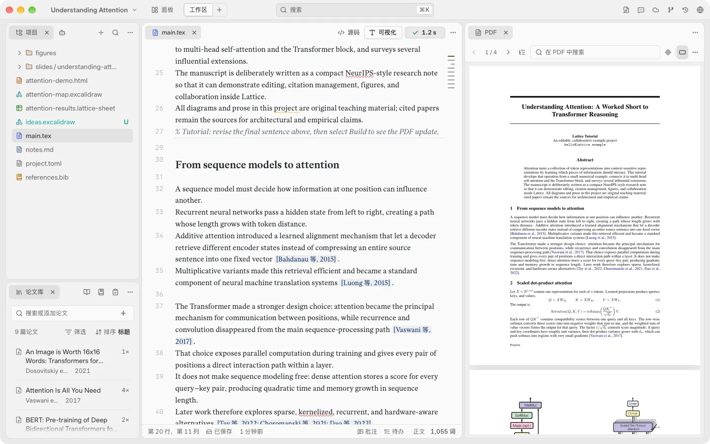
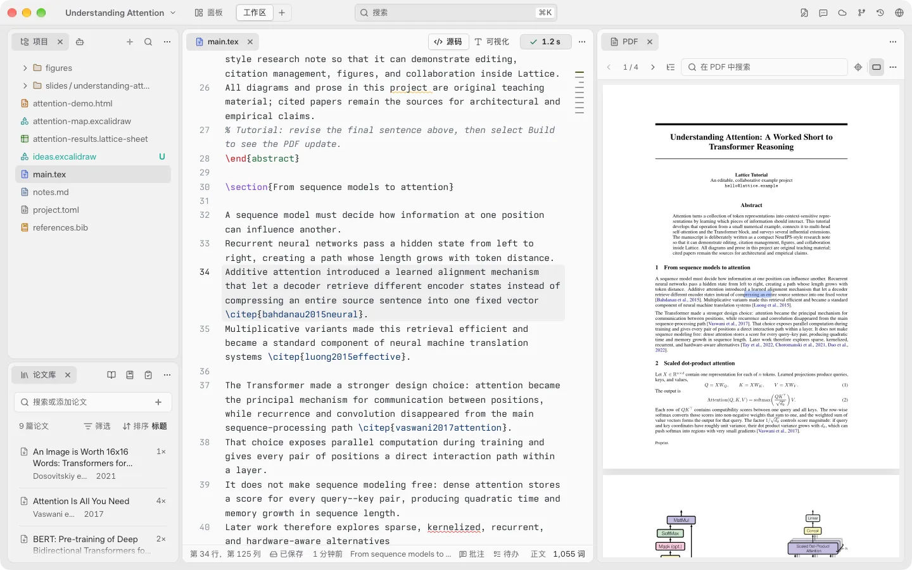

# 写作

## 编辑器

`.tex` 文件在源码编辑器中打开，输入时有补全和诊断。编辑器上方可以切换：

- **源码**：LaTeX 原文。
- **可视化内容**：同一个文件，标题、强调、公式、列表和图片直接渲染出来。编辑的仍是同一份文本，随时可以切回。

写作时常用的功能：

- **格式快捷键**：`⌘B` 加粗、`⌘I` 强调、`⌘⇧M` 行内公式、`⌘/` 注释一行、`⌘⌥E` 套上公式环境。完整列表见 **快捷键**（`⌘?`）。
- **查找替换**：`⌘F` 在当前文件，`⌘⇧F` 在整个项目。
- **跳转**：`⌘P` 打开任意文件，`⌘G` 跳到某行，`⌘⇧O` 跳到某节或某个 label。
- **大纲**：状态栏里的章节名，以及编辑器右边缘的标记，可以按文档结构跳转。
- Markdown 笔记、表格、HTML 页面、幻灯片和 [白板](boards.md) 都放在同一个项目里，用各自的编辑器打开。

Lattice 边写边保存，状态栏的 **已保存** 显示保存时间。

## 源码旁边的 PDF

每次保存都会编译 PDF（见 [编译与排错](building.md)），PDF 面板原地刷新。在两者之间跳转：

- 在 PDF 里 **双击** 一句话，跳到写出它的源码行。
- 在源码里按 `⌘⇧J`（**在 PDF 中查看**），在 PDF 中显示当前行。

PDF 也可以放进单独的窗口，适合用第二块屏幕：在命令面板（`⌘K`）里搜索「在单独窗口中打开 PDF」。
